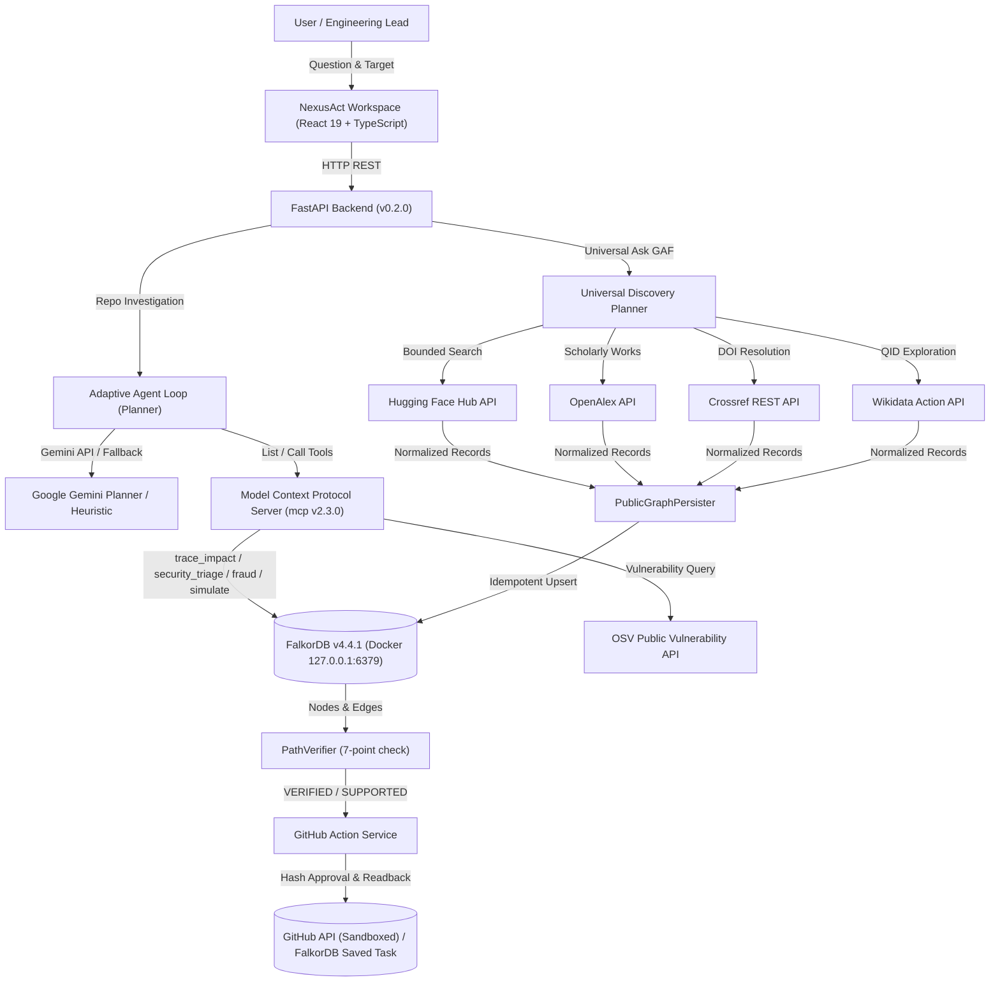

# NexusAct

**Graph-Native AI That Investigates, Simulates, and Acts**  
*Architecture: GraphAction Fabric (GAF)*

[](https://github.com/VishwanathArchakMR/NexusAct/actions/workflows/ci.yml)
[](https://www.falkordb.com/)
[](https://fastapi.tiangolo.com/)
[](https://modelcontextprotocol.io/)
[](https://react.dev/)
[](https://www.typescriptlang.org/)
[](https://opensource.org/licenses/MIT)
[](./tests)
[](./frontend/tests)

> **FalkorDB Hackathon Submission**  
> **Track:** *Agents That Act on Connected Data*  
> **Primary Database:** FalkorDB v4.4.1 (Redis Protocol / Cypher)  
> **Hackathon Submission Checklist:** [`docs/SUBMISSION_CHECKLIST.md`](docs/SUBMISSION_CHECKLIST.md)  
> **Phase 20 Acceptance Matrix:** [`docs/PHASE20_ACCEPTANCE.md`](docs/PHASE20_ACCEPTANCE.md)  
> **Phase 20 Final Report:** [`docs/PHASE20_FINAL_REPORT.md`](docs/PHASE20_FINAL_REPORT.md)  
> **Phase 19 Acceptance Matrix:** [`docs/PHASE19_ACCEPTANCE.md`](docs/PHASE19_ACCEPTANCE.md)  
> **Live Demo Walkthrough:** [`docs/DEMO_SCRIPT.md`](docs/DEMO_SCRIPT.md)  

---

## 1. Executive Summary

**NexusAct** is a graph-native AI engineering agent that investigates software repositories and connected data ecosystems as interactive, auditable knowledge graphs.

Built on the **GraphAction Fabric (GAF)** architecture, NexusAct operates across four first-class input modes:
1. **Software Repository Domain (Software Graph):** AST dependency parsing (Python, TypeScript, JavaScript/React), bounded reverse impact traversal, contributor expertise ranking, structural centrality (PageRank), counterfactual simulation with `GRAPH.COPY` isolation, interactive dual-mode SVG graph explorer (Investigation Path & Network Overview), and cryptographically verified GitHub action proposals.
2. **Universal Public-Data Domain (Mode A):** Bounded discovery across AI models and datasets (Hugging Face Hub), scholarly publications and citations (OpenAlex, Crossref), and organizations, researchers, and topics (Wikidata). All records are persisted idempotently into FalkorDB with strict provenance tracing and evidence links.
3. **Public Vulnerability Security Triage (OSV):** Dynamic dependency analysis against OSV (Open Source Vulnerabilities) public database. Maps declared manifests (`package.json`, `package-lock.json`, `requirements.txt`) to `PackageDependency` and `Vulnerability` nodes in FalkorDB, tracing paths to consuming internal modules.
4. **Bounded Synthetic Fraud Investigation:** Multi-hop graph traversal over isolated `nexusact_fraud_demo` graph detecting rapid circular transfer rings (`acc:101 -> acc:102 -> acc:103 -> acc:101`), shared device infrastructure (`dev:iphone_xyz`), and verified benign control baselines.
5. **Google Gemini LLM Planning Adapter:** Server-side function-calling and structured tool budget execution using official `google-genai` SDK (`gemini-2.5-flash`). Enforces tool allowlist and deterministic fallback.
6. **Safe Internal Action Persistence:** Safe `SAVED` state in FalkorDB when GitHub credentials are unset, preventing unauthenticated remote execution.
7. **Judge-Ready Project Explorer & Live Diagnostics:** Collapsible 3-column repository explorer with bounded file tree, AST symbol navigation, and direct FalkorDB graph relationship linkage; real-time operational diagnostics replacing legacy roadmap cards; dual-mode graph explorer (Path View vs Network Overview) with bidirectional graph/source synchronization; and an accessible, high-contrast light/dark design system (#0B1F3A primary navy).
8. **Real Graph-Grounded Investigation Engine (Phase 19):** Dynamic, question-aware planning loop without hardcoded sequences; flow and reachability analysis across Codebase Walkthrough, OSV Security Triage, and isolated Financial Fraud topology; seamless Code Inspector cross-navigation; transparent FalkorDB Cypher risk indicator calculations; and resilient loop detection.
9. **Final Judge-Ready Experience & Evidence Grounding (Phase 20):** Persistent vertical navigation across Explore, Analyze, Evidence & Action, and Specialized Workflows; grounded panel explanations across all 10 panels with SHA-256 LRU caching; truthful Gemini and fallback disclosure (`GEMINI_ACTIVE`, `FALLBACK_ACTIVE`); and verified genuine multi-hop reasoning over live FalkorDB graph data.

---

## 2. Technical Architecture: GraphAction Fabric (GAF)



### Graph Model & Domain Separation

NexusAct maintains strict physical and logical graph isolation in FalkorDB:
- **Software Codebase Graphs (`nexusact_main`, `repo_*`):**
  - **Canonical Dependency Direction:** `(DependentModule)-[:DEPENDS_ON]->(DependencyModule)`. Reverse-impact analysis traverses upstream callers pointing to the target dependency.
  - **Schema:** `Module`, `File`, `Person`, `Commit`, `PackageDependency`, `Vulnerability`, `SecurityFinding`.
- **Synthetic Fraud Graph (`nexusact_fraud_demo`):**
  - Dedicated isolated demonstration namespace for multi-hop financial topology analysis.
  - **Schema:** `Account`, `Person`, `Device`, `IPAddress`, `Merchant`, `Transaction`.
  - **Relationships:** `OWNS`, `USES_DEVICE`, `USES_IP`, `SENDS_TO`, `PAYS`.
- **Public Knowledge Graphs (`nexusact_public`):**
  - Independent discovery space for AI models, datasets, papers, authors, and organizations.
  - **Schema:** `Model`, `Dataset`, `Paper`, `Organization`, `Topic`, `SourceRecord`, `Investigation`.
- **Evidence Provenance:** Edges store `evidence_type` (`observed`, `derived`, `inferred`), `source_file`, confidence (`EXACT`, `HIGH`, `SUPPORTED`), and source provenance URLs.

### Essential Cypher Queries & Graph Algorithms

FalkorDB performs non-trivial, graph-native computation essential to NexusAct:

1. **Reverse Dependency Impact Traversal (Up to 4 Hops):**
   ```cypher
   MATCH path = (caller:Module)-[:DEPENDS_ON*1..4]->(target:Module {id: $target_id})
   RETURN caller.id, caller.name, length(path) AS depth, [r IN relationships(path) | r.id] AS rel_ids
   ORDER BY depth ASC
   ```

2. **Multi-Hop Shortest Path Traversal:**
   ```cypher
   MATCH (src:Module {id: $src_id}), (dst:Module {id: $dst_id})
   WITH src, dst, shortestPath((src)-[:DEPENDS_ON*]->(dst)) AS path
   RETURN [n IN nodes(path) | n.id] AS path_nodes, [r IN relationships(path) | type(r)] AS rel_types, length(path) AS hops
   ```

3. **PageRank Structural Centrality:**
   ```cypher
   CALL algo.pageRank('Module', 'DEPENDS_ON', {damping: 0.85, iterations: 20})
   YIELD node, score
   RETURN node.id AS module_id, node.name AS module_name, score
   ORDER BY score DESC LIMIT $top_k
   ```

4. **Counterfactual Simulation via Isolated Clone (`GRAPH.COPY`):**
   ```cypher
   GRAPH.COPY nexusact_main scenario_sim_a1b2c3d4
   // In clone: excises target module and recalculates surviving vs broken paths
   MATCH (m:Module {id: $target_id}) DETACH DELETE m
   // Comparison query between baseline and cloned scenario
   // Clone is guaranteed destroyed in finally block:
   GRAPH.DELETE scenario_sim_a1b2c3d4
   ```

5. **Evidence-Based Contributor & Reviewer Expertise (who_knows):**
   ```cypher
   MATCH (p:Person)-[:AUTHORED]->(c:Commit)-[:TOUCHES]->(f:File)<-[:CONTAINS]-(m:Module)
   WHERE m.id IN $affected_modules
   RETURN p.id, p.name, count(DISTINCT f.id) AS files_touched, count(DISTINCT c.id) AS commits, max(c.timestamp) AS recency
   ORDER BY files_touched DESC
   ```

---

## 3. Technology Stack & Environment

| Component | Technology | Version |
|---|---|---|
| **Operating System** | Windows 11 with WSL2 runtime | - |
| **Graph Database** | FalkorDB (Docker Container) | `v4.4.1` (Pinned) |
| **Python** | CPython managed via `uv` | `3.12.8` |
| **Backend** | FastAPI, Pydantic v2, Uvicorn | `0.115+` / `2.14+` |
| **MCP SDK** | Official Python `mcp` SDK | `2.3.0` |
| **Frontend** | React, TypeScript, Vite, Lucide | `19.2.8` / `6.0.2` / `8.3.4` |
| **Public Connectors** | Hugging Face, OpenAlex, Crossref, Wikidata | Fixed API Constants |
| **Local LLM** | Ollama (Local-first) / Heuristic Fallback | Configurable |
| **Quality Suite** | Pytest, Ruff, Mypy, Oxlint, Vitest | **146/146 python, 20/20 vitest — all clean** |

---

## 4. Quick Start & Local Run Commands

### 1. Prerequisites

- Docker Desktop with WSL2 integration (or bare WSL2 Docker daemon)
- Python 3.11+ with `uv` installed
- Node.js 22+

### 2. Start All Services (Resilient Startup)

```powershell
# Starts FalkorDB, verifies Cypher readiness via Python probe (survives Redis AOF loading),
# launches FastAPI backend (8000), and starts Vite frontend (5173)
.\scripts\start.ps1
```

### 3. Check Service Status & Readiness

```powershell
# Non-destructive status check verifying FalkorDB, FastAPI, and Vite
.\scripts\status.ps1
```

### 4. Ingest Repository into FalkorDB

```powershell
# Runs AST parser and Git history extractor on the local workspace
.\scripts\ingest.ps1
```

### 5. Run Quality & Validation Suite

```powershell
# Runs ruff, mypy, pytest (118 tests), oxlint, vitest (13 tests), and production build
.\scripts\check.ps1
```

### 6. Production Local Deployment (All Three Services via Docker)

```powershell
# Build and start all services with persistent storage
docker compose -f docker-compose.prod.yml up --build -d

# Access frontend at http://localhost:3000
```

### 7. Stop Local Services

```powershell
.\scripts\stop.ps1
```

---

## 5. Live Deployment Options

See [`docs/DEPLOYMENT.md`](docs/DEPLOYMENT.md) for a full, honest assessment of free-tier deployment options.

### Summary

| Option | Cost | Persistence | Verdict |
|---|---|---|---|
| **Local docker-compose.prod.yml** | Free | ✅ Full AOF persistence | ✅ Recommended |
| **FalkorDB Cloud Free + Render.com** | Free | ⚠️ Demo only (no backups) | ⚠️ Hackathon demo only |
| **Railway.app Trial** | $5 trial credit | ✅ 0.5 GB volume | ✅ Best live option |

> **Honest note:** A fully persistent, always-on deployment at true zero cost is not available because FalkorDB requires a stateful process. The local docker-compose approach is the most reliable option for demos and production.

---

## 6. Security & Isolation Guarantees

1. **Docker Daemon Security:** The Docker daemon running inside WSL2 binds to loopback-only (`127.0.0.1:2375`). Never exposed on `0.0.0.0`.
2. **Database Protection:** The primary graph (`nexusact_main`) is listed in `PROTECTED_GRAPHS`. Counterfactual simulations clone via `GRAPH.COPY` and strictly delete temporary clones in `finally` blocks.
3. **No Dynamic Cypher Injection:** All Cypher queries use parameterized inputs with typed Pydantic payloads.
4. **Action Approval Binding:** Issue proposals compute a canonical SHA-256 hash. External submission requires the exact approved hash.
5. **Idempotency Reconciliation:** Every proposed issue embeds a `<!-- GAF-ACTION-MARKER:<hash> -->` marker to prevent duplicates.
6. **Honest Fallback:** If Ollama, Gemini, or GitHub tokens are unconfigured, NexusAct operates with full local graph intelligence and previews without fabricating fake reviews or external states.
7. **TrustedHostMiddleware:** Enabled in `APP_ENV=production` to prevent Host header injection attacks.
8. **Non-root Docker containers:** Both backend and frontend containers run as a non-root `nexusact` system user.
9. **API Docs hidden in production:** Swagger UI and ReDoc are disabled when `APP_ENV=production`.

---

## 7. Verification Reports & Demonstration

- **Phase 14 Final Report:** [`docs/PHASE14_FINAL_REPORT.md`](docs/PHASE14_FINAL_REPORT.md) — Comprehensive release rescue, FalkorDB LOADING resolution, end-to-end live workflow verification, and hackathon submission.
- **Phase 14 Acceptance Matrix:** [`docs/PHASE14_ACCEPTANCE.md`](docs/PHASE14_ACCEPTANCE.md) — Detailed requirement-by-requirement test and limitation mapping.
- **Phase 13 Completion Report:** [`docs/PHASE13_COMPLETION_REPORT.md`](docs/PHASE13_COMPLETION_REPORT.md) — OSV security triage, synthetic fraud investigation, and Gemini integration.
- **Live Demonstration Guide:** [`docs/DEMO_SCRIPT.md`](docs/DEMO_SCRIPT.md) — Step-by-step reproducible live demo script with video recording checklist.
- **Phase 12 Final Report:** [`docs/PHASE12_FINAL_REPORT.md`](docs/PHASE12_FINAL_REPORT.md) — Graph-truth audit, test outputs, and hackathon acceptance.
- **Deployment Guide:** [`docs/DEPLOYMENT.md`](docs/DEPLOYMENT.md) — Production Compose and cloud hosting analysis.

---

## 8. AI-Assisted Development Disclosure

In accordance with the hackathon rules and transparency standards:
- **AI Coding Assistant Usage:** Generative AI tools (Google Antigravity IDE agentic workflows) were utilized during the development lifecycle for interactive pair programming, test fixture authoring, AST parser refinement, and documentation scaffolding.
- **Human Responsibility & Oversight:** The author conceived the system architecture (GraphAction Fabric), designed the FalkorDB graph schema and Cypher query patterns, established the security and cryptographic approval boundaries, debugged execution and rendering failures, verified all automated test suites, and retains full responsibility for the correctness, safety, and integrity of the submitted codebase.

