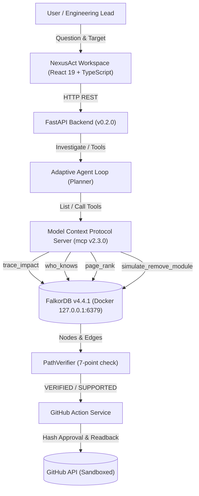

# NexusAct

**Graph-Native AI That Investigates, Simulates, and Acts**  
*Architecture: GraphAction Fabric (GAF)*

[](https://www.falkordb.com/)
[](https://fastapi.tiangolo.com/)
[](https://modelcontextprotocol.io/)
[](https://react.dev/)
[](https://www.typescriptlang.org/)
[](https://opensource.org/licenses/MIT)

---

## 1. Executive Summary

**NexusAct** is a graph-native AI engineering agent that investigates software repositories as connected graphs.

A user asks:
> *"If I change this module, which other modules may be affected, who has relevant experience, what happens if the module is removed in a simulated graph, and can you create an issue explaining the findings?"*

NexusAct executes this complete, end-to-end investigation:
1. **Repository Ingestion:** Ingests an actual local Git repository into FalkorDB via Python AST parsing and Git commit history.
2. **Reverse Impact Analysis (`trace_impact`):** Traverses upstream reverse-dependencies up to 4 hops (`DependentModule -[:DEPENDS_ON]-> DependencyModule`).
3. **Reviewer Discovery (`who_knows`):** Computes evidence-backed reviewer rankings with a transparent 4-part scoring formula (files touched, recency, ownership, and peer reviews).
4. **Structural Centrality (`page_rank`):** Identifies structurally influential components using FalkorDB native PageRank (`CALL algo.pageRank('Module', 'DEPENDS_ON')`).
5. **Counterfactual Simulation (`simulate_remove_module`):** Clones the graph via `GRAPH.COPY`, removes the target module in the temporary copy, computes broken paths and blast radius score, logs the scenario, and cleans up the temporary clone.
6. **Path Verification (`PathVerifier`):** Validates all paths, node/edge IDs, directions, and source file evidence against FalkorDB, emitting `VERIFIED`, `SUPPORTED`, `CONTRADICTED`, or `UNKNOWN`.
7. **Adaptive MCP Agent:** The agent discovers registered tools over MCP and adaptively selects tools based on intermediate findings, persisting `Investigation` and `ToolInvocation` records in FalkorDB.
8. **Interactive Frontend:** Renders real dependency graphs, agent tool execution traces, reviewer evidence, counterfactual before/after diffs, and issue proposals.
9. **Verified GitHub Action:** Generates issue proposals with canonical SHA-256 payload hash binding and idempotency markers (`<!-- GAF-ACTION-MARKER:<hash> -->`), submits to GitHub when approved, and verifies via independent read-back.

---

## 2. Technical Architecture: GraphAction Fabric (GAF)



### Graph Model & Canonical Semantics
- **Canonical Dependency Direction:** `(DependentModule)-[:DEPENDS_ON]->(DependencyModule)`. Reverse-impact analysis traverses upstream callers pointing to the target dependency.
- **Node Labels:** `Repository`, `Module`, `File`, `Person`, `Commit`, `Investigation`, `ToolInvocation`, `Scenario`, `ScenarioResult`, `Action`, `ActionOutcome`.
- **Relationship Types:** `DEPENDS_ON`, `CONTAINS`, `AUTHORED`, `TOUCHES`, `USED_TOOL`, `HAS_SCENARIO`, `CREATED_ACTION`, `HAS_OUTCOME`.
- **Evidence Provenance:** Edges store `evidence_type` (`observed`, `derived`, `inferred`), `source_file`, and commit references.

---

## 3. Technology Stack & Environment

| Component | Technology | Version |
|---|---|---|
| **Operating System** | Windows 11 with WSL2 runtime | - |
| **Graph Database** | FalkorDB (Docker Container) | `v4.4.1` (Pinned) |
| **Python** | CPython managed via `uv` | `3.12.8` |
| **Backend** | FastAPI, Pydantic v2, Uvicorn | `0.115+` / `2.14+` |
| **MCP SDK** | Official Python `mcp` SDK | `2.3.0` |
| **Frontend** | React, TypeScript, Vite, Lucide | `19.2.8` / `6.0.2` / `8.3.4` |
| **Local LLM** | Ollama (Local-first) / Heuristic Fallback | Configurable |
| **Quality Suite** | Pytest, Ruff, Mypy, Oxlint, Vitest | All clean (33/33 python, 8/8 vitest) |

---

## 4. Quick Start & Local Run Commands

### 1. Start Services
```powershell
# Starts FalkorDB, launches FastAPI backend (8000), and starts frontend (5173)
.\scripts\start.ps1
```

### 2. Ingest Repository into FalkorDB
```powershell
# Runs AST parser and Git history extractor on the local workspace
.\scripts\ingest.ps1
```

### 3. Run Quality & Validation Suite
```powershell
# Runs ruff, mypy, pytest (33 tests), oxlint, vitest (8 tests), and production build
.\scripts\check.ps1
```

### 4. Stop Local Services
```powershell
.\scripts\stop.ps1
```

---

## 5. Security & Isolation Guarantees

1. **Docker Daemon Security:** The Docker daemon running inside WSL2 is explicitly hardened to loopback-only binding (`127.0.0.1:2375`). It is never exposed on `0.0.0.0`.
2. **Database Protection:** The primary graph (`nexusact_main`) is protected in code (`PROTECTED_GRAPHS`). Counterfactual simulations clone via `GRAPH.COPY` and strictly delete temporary clones in `finally` blocks, preserving the source graph under all failure scenarios.
3. **No Dynamic Cypher Injection:** All Cypher queries use parameterized inputs with typed Pydantic payloads.
4. **Action Approval Binding:** Issue proposals compute a canonical SHA-256 hash. External submission requires the exact approved hash; any payload tampering is rejected.
5. **Idempotency Reconciliation:** Every proposed issue embeds a `<!-- GAF-ACTION-MARKER:<hash> -->` marker. Timeouts trigger a duplicate search before considering retries, avoiding duplicate issues.
6. **Honest Fallback:** If Ollama or GitHub tokens are unconfigured, NexusAct operates honestly with full local graph intelligence and previews without fabricating fake reviews or external states.
