# NexusAct — Graph-Native AI That Investigates, Simulates, and Acts

[](https://github.com/VishwanathArchakMR/NexusAct/actions/workflows/ci.yml)
[](https://www.falkordb.com/)
[](https://fastapi.tiangolo.com/)
[](https://modelcontextprotocol.io/)
[](https://react.dev/)
[](https://www.typescriptlang.org/)
[](https://opensource.org/licenses/MIT)

> **FalkorDB Graph Hacks Hackathon Submission**  
> **Track:** **Agents That Act on Connected Data**  
> **Primary Graph Database:** FalkorDB v4.4.1 (Redis Protocol / Low-Latency Cypher Engine)  
> **Architecture:** GraphAction Fabric (GAF)  
> **Repository:** [https://github.com/VishwanathArchakMR/NexusAct](https://github.com/VishwanathArchakMR/NexusAct)  

---

## 1. Project Overview & The Problem

Software systems, vulnerability chains, contributor networks, and financial transaction streams are inherently **connected graphs**. Yet conventional AI coding and security assistants treat codebases as flat text embeddings or keyword indices. When queried about architectural impact, author expertise, or cascading vulnerabilities, standard LLMs suffer from severe hallucinations—inventing nonexistent imports, missing multi-hop blast radii, and proposing unvetted code changes.

**NexusAct** solves this by establishing **FalkorDB v4.4.1** as the central, deterministic reasoning engine for AI agents. 

Rather than relying on flat vector similarity, NexusAct represents code structures, Git histories, and financial relationships as rich property graphs. When a user asks an architectural question, initiates an impact simulation, or explores a fraud cluster, NexusAct dynamically queries FalkorDB using Cypher, performs multi-hop path traversals, runs counterfactual simulations in isolated sandbox clones, and returns answers strictly grounded in verified graph evidence.

---

## 2. Competition Track & Key Differentiators

**Track:** **Agents That Act on Connected Data**

NexusAct demonstrates that an autonomous agent is only as reliable as the graph data backing its decisions:

1. **FalkorDB as the Primary Reasoning Engine:**  
   FalkorDB is not merely a database backing a UI visualization; it is the core execution substrate. Schema discovery, shortest path traversals, PageRank centrality, dependency reachability, and historical author rankings are computed natively in FalkorDB via Cypher queries and graph algorithms.
2. **Counterfactual Dependency Simulation via Ephemeral Graph Clones:**  
   When assessing the blast radius of deprecating or removing a software module, NexusAct uses FalkorDB's native `GRAPH.COPY` command to create an isolated, ephemeral sandbox clone (`scen_<uuid>`). It severs the candidate module in the sandbox, computes severed vs. surviving paths, and cleans up the clone with `GRAPH.DELETE`—leaving the primary graph 100% untouched.
3. **Model Context Protocol (MCP v2.3) Tool Exposure:**  
   Graph reasoning primitives (`trace_dependency_impact`, `who_knows`, `simulate_removal`, `detect_cycles`) are exposed through standard MCP tools, allowing any MCP-compliant agent or client to act directly on connected graph data.
4. **Graph-Grounded AI Chat with Verifiable Evidence:**  
   The right-side Graph AI Chat assistant queries FalkorDB dynamically for schema labels and relationships, constructs bounded read-only Cypher queries, validates them against mutation injection, and synthesizes answers that cite concrete nodes, paths, and millisecond query execution traces.
5. **Human-in-the-Loop Cryptographic Action Gating:**  
   When the agent proposes an external remediation action (such as filing a GitHub issue), it calculates a canonical SHA-256 hash of the proposal. External execution requires explicit human review and cryptographic hash verification to prevent execution of tampered or hallucinated payloads.
6. **Strict Domain & Namespace Isolation:**  
   Codebase repositories (`nexusact_main`, `repo_*`), financial transaction callsets (`fin_*`), and scenario simulations (`scen_*`) reside in strictly segregated FalkorDB graphs, preventing cross-domain schema or data leakage.

---

## 3. Demonstration Video

<!-- DEMO VIDEO LINK PLACEHOLDER -->
> **Demo Walkthrough Video:**  
> [NexusAct Demo Video (YouTube / Loom) — Walkthrough Link Placeholder](https://github.com/VishwanathArchakMR/NexusAct)  
> *(The demonstration video will be recorded following the structured 3-minute script in [`docs/FINAL_DEMO_CHECKLIST.md`](docs/FINAL_DEMO_CHECKLIST.md) and linked here.)*

---

## 4. Key Features

| Feature | Description | Graph Implementation & Limitations |
| :--- | :--- | :--- |
| **Interactive Graph Explorer** | 2D visual canvas rendering modules, files, packages, and contributors with interactive node-type coloring, physics layout, and dynamic filtering. | Queries `MATCH (n)-[r]->(m) RETURN n, r, m LIMIT 80`. Bounded for UI performance. |
| **Code Inspector & File Tree** | Source-aware code browser with directory hierarchy, syntax highlighting, and bidirectional navigation from graph nodes to physical source lines. | Resolves `m.path` against the active repository snapshot. Probes multi-language extensions (`.tsx`, `.ts`, `.py`). |
| **Counterfactual Scenario Simulation** | Excises candidate modules and measures architectural blast radius across upstream callers. | Uses `GRAPH.COPY` to clone the graph into `scen_*`, executes `DETACH DELETE`, compares before/after reachability, and drops the clone with `GRAPH.DELETE`. Truthfully reports zero impact for leaves. |
| **Reviewers & Authors Intelligence** | Recommends domain experts and reviewers for any target module or file based on historical Git commit activity. | Traverses `(:Person)-[:AUTHORED]->(:Commit)-[:TOUCHES]->(:File)<-[:CONTAINS]-(:Module)`. Applies weighted ranking (40% files, 30% recency, 20% ownership, 10% reviews). Discloses when PR review data is absent. |
| **Graph AI Chat (Right-Side Drawer)** | Context-aware AI assistant bound to the active repository or financial dataset. Generates read-only Cypher, executes it in FalkorDB, and returns evidence-grounded answers. | Powered by Google Gemini 2.5 Flash when configured. Falls back gracefully to deterministic graph templates if unconfigured. Strictly blocks mutating Cypher statements. |
| **MCP Tool Traces & Audit History** | Real-time audit log of executed tools, Cypher queries, millisecond execution latencies, and returned graph rows. | Stored in FalkorDB as `(:Investigation)-[:INVOKED]->(:ToolInvocation)` records. |
| **Security & Vulnerability Triage** | Correlates third-party package dependencies against the OSV.dev vulnerability database and traces reachability to internal code modules. | Traverses `(:Module)-[:REQUIRES_PACKAGE]->(:PackageDependency)-[:HAS_VULNERABILITY]->(:Vulnerability)`. |
| **Financial Fraud Investigation** | Ingests transaction datasets into isolated graphs, detecting 3- to 5-hop circular routing loops and shared device/IP infrastructure. | Traverses `(:Account)-[:SENDS_TO*3..5]->(:Account)` and `(:Account)-[:USES_DEVICE]->(:Device)`. Features a transparently labeled synthetic AML benchmark. Risk scores are investigative signals, not legal findings. |
| **Verified Safe Action Workflow** | Creates structured remediation proposals with a canonical SHA-256 payload lock and approval status. | Stored as `(:Action {status, approved_payload_hash})`. Prevents unapproved external writes to GitHub or financial endpoints. |

---

## 5. System Architecture

```mermaid
flowchart TD
    subgraph Frontend["React 19 Frontend (TypeScript + Vite)"]
        UI["NexusAct Workspace"]
        Drawer["Graph AI Chat Drawer (Right-Side)"]
        SimPanel["Scenario Simulation Panel"]
        RevPanel["Reviewers & Authors Panel"]
        CodePanel["Code Inspector & AST Tree"]
        FraudPanel["Financial Fraud Investigation"]
    end

    subgraph Ingress["Production Ingress & Reverse Proxy"]
        Caddy["Caddy v2.9 (Auto HTTPS / Let's Encrypt :80 / :443)"]
    end

    subgraph Backend["FastAPI Backend (:8000)"]
        Router["API Router (/api/v1)"]
        Registry["Trusted Source & Dataset Registry"]
        ChatService["GraphChatService"]
        AgentLoop["Adaptive Investigation Agent"]
        SimEngine["Scenario Simulation Engine"]
        IngestEngine["AST & Git Ingestion Pipeline"]
        FinanceEngine["Financial Normalization Engine"]
        ActionService["Verified Action Service (SHA-256 Lock)"]
    end

    subgraph LLM_Subsystem["LLM Planning & Grounding"]
        Provider["Google Gemini 2.5 Flash / Deterministic Fallback"]
        CypherValidator["Read-Only Cypher Safety Barrier"]
    end

    subgraph FalkorDB_Engine["FalkorDB Graph Database (:6379)"]
        BaseGraph[("Base Codebase Graph:\nnexusact_main / repo_*")]
        EphemeralClone[("Ephemeral Scenario Clone:\nscen_<uuid>")]
        FinGraph[("Isolated Financial Graph:\nfin_<dataset_id>")]
    end

    subgraph Ext_Tools["External Services"]
        MCP["Model Context Protocol Server (mcp v2.3)"]
        OSV["OSV.dev Vulnerability API"]
        GitRemote["GitHub API (Human-Approved Issues)"]
    end

    %% Ingress & Routing
    Frontend -.->|Relative /api/v1/*| Caddy
    Caddy -->|Proxy :8000| Router

    %% User Interactions
    Router --> ChatService
    Router --> SimEngine
    Router --> IngestEngine
    Router --> FinanceEngine
    Router --> ActionService

    %% Source Registry Resolution
    ChatService --> Registry
    SimEngine --> Registry
    FinanceEngine --> Registry
    Registry -.->|Authoritative Graph Name & Revision| FalkorDB_Engine

    %% Graph AI Chat Grounded Lifecycle
    ChatService -->|1. Request Dynamic Schema| BaseGraph
    BaseGraph -->|2. Labels & Rel Types| ChatService
    ChatService -->|3. Question + Schema Prompt| Provider
    Provider -->|4. Generate Cypher Query| CypherValidator
    CypherValidator -->|5. Block Mutations / Verify Read-Only| BaseGraph
    BaseGraph -->|6. Real Evidence Rows & Paths| ChatService
    ChatService -->|7. Grounded Answer Prompt + Evidence| Provider
    Provider -->|8. Natural Language Synthesis| ChatService
    ChatService -->|9. Answer + Trace + Evidence Chips| Drawer

    %% Scenario Simulation Isolation Flow
    SimEngine -->|1. GRAPH.COPY BaseGraph EphemeralClone| BaseGraph
    BaseGraph --> EphemeralClone
    SimEngine -->|2. DETACH DELETE Target Module| EphemeralClone
    EphemeralClone -->|3. Measure Severed & Surviving Paths| SimEngine
    SimEngine -->|4. GRAPH.DELETE EphemeralClone| EphemeralClone
    SimEngine -->|5. Base Graph 100% Preserved| BaseGraph

    %% Agent Loop and MCP
    Router --> AgentLoop
    AgentLoop --> MCP
    MCP --> OSV
    MCP --> BaseGraph

    %% Action Verification
    ActionService -->|SHA-256 Hash Verified| GitRemote
```



---

## 6. Graph Data Model

NexusAct partitions its data into explicit, isolated graph namespaces.

### 6.1 Software Engineering Graph (`nexusact_main`, `repo_<repo_id>`)

| Node Label | Key Properties | ID Convention / Description |
| :--- | :--- | :--- |
| `Repository` | `id`, `name`, `url_or_path`, `commit_sha`, `source_type` | Root container for the codebase snapshot. |
| `Module` | `id`, `name`, `path`, `language`, `loc` | Granular architectural component or logical module. |
| `File` | `id`, `path`, `extension`, `size_bytes` | Physical file on disk. |
| `Person` | `id`, `name`, `email` | Contributor, author, or reviewer. |
| `Commit` | `id`, `sha`, `message`, `timestamp`, `insertions`, `deletions` | Git commit history changeset. |
| `PackageDependency` | `id`, `name`, `version`, `ecosystem` | Third-party dependency declared in package manifests. |
| `Vulnerability` | `id`, `osv_id`, `summary`, `severity`, `fixed_version` | Known security vulnerability advisory. |
| `Investigation` | `id`, `query`, `status`, `created_at` | Agent investigation session tracking. |
| `ToolInvocation` | `id`, `tool_name`, `parameters`, `duration_ms` | Audit record of an executed MCP tool. |
| `Action` | `id`, `title`, `body`, `status`, `approved_payload_hash` | Human-gated remediation proposal. |

#### Canonical Software Relationships
- `(:Module)-[:DEPENDS_ON]->(:Module)`: **Canonical dependency direction** (`caller -DEPENDS_ON-> dependency`).
- `(:Module)-[:CONTAINS]->(:File)`: Module to physical disk file linkage.
- `(:Person)-[:AUTHORED]->(:Commit)`: Contributor commit authorship.
- `(:Commit)-[:TOUCHES]->(:File)`: Files modified in a commit changeset.
- `(:Person)-[:REVIEWS]->(:Commit)`: Peer review metadata (when PR reviews are ingested).
- `(:Module)-[:REQUIRES_PACKAGE]->(:PackageDependency)`: Third-party package requirement.
- `(:PackageDependency)-[:HAS_VULNERABILITY]->(:Vulnerability)`: Reachable vulnerability binding.

### 6.2 Financial Fraud Graph (`fin_<dataset_id>`)

| Node Label | Key Properties | ID Convention / Description |
| :--- | :--- | :--- |
| `Account` | `id`, `account_number`, `holder_name`, `risk_score` | Financial entity or bank account. |
| `Transaction` | `id`, `tx_id`, `amount`, `currency`, `timestamp`, `is_fraud` | Monetary transfer record. |
| `Device` | `id`, `device_id`, `device_type` | Hardware or browser fingerprint. |
| `IPAddress` | `id`, `ip_address`, `asn`, `country` | Network client IP address. |
| `Merchant` | `id`, `name`, `category` | Commercial payment receiver. |

#### Canonical Financial Relationships
- `(:Account)-[:SENDS_TO {amount, timestamp, tx_id}]->(:Account)`: Directed monetary transaction.
- `(:Account)-[:USES_DEVICE]->(:Device)`: Hardware fingerprint binding.
- `(:Account)-[:LOGS_FROM_IP]->(:IPAddress)`: Network client binding.
- `(:Account)-[:PAYS_MERCHANT]->(:Merchant)`: Commercial destination.

---

## 7. Essential Cypher Queries & Graph Algorithms

Every query executed by NexusAct is validated, bounded, and tuned for FalkorDB v4.4.1:

### 1. Bounded Shortest Path Between Modules
```cypher
MATCH (start:Module {name: $start_name}), (target:Module {name: $target_name})
MATCH p = shortestPath((start)-[:DEPENDS_ON*1..6]->(target))
RETURN [n in nodes(p) | n.name] AS path_nodes, length(p) AS hops
```
- **Purpose:** Identifies the direct architectural dependency chain between two modules.
- **Direction:** Follows outgoing `DEPENDS_ON` edges up to 6 hops deep.

### 2. Upstream Dependency Blast Radius (Who Depends On Me?)
```cypher
MATCH (target:Module {name: $module_name})
MATCH (caller:Module)-[:DEPENDS_ON*1..3]->(target)
RETURN DISTINCT caller.name AS dependent_module, caller.path AS file_path
LIMIT 50
```
- **Purpose:** Determines all upstream components that would break if the target module is modified or deprecated.
- **Direction:** Inward traversal (`caller -> target`).

### 3. Contributor Expertise From Commit History
```cypher
MATCH (p:Person)-[:AUTHORED]->(c:Commit)-[:TOUCHES]->(f:File)<-[:CONTAINS]-(m:Module {name: $module_name})
RETURN p.name AS author_name,
       p.email AS author_email,
       count(DISTINCT c) AS commit_count,
       count(DISTINCT f) AS files_touched,
       max(c.timestamp) AS latest_commit
ORDER BY commit_count DESC
LIMIT 10
```
- **Purpose:** Identifies domain experts who actively maintain files inside a specific module boundary.

### 4. Counterfactual Path Comparison via Native `GRAPH.COPY`
```cypher
-- Step 1: Duplicate active graph to ephemeral sandbox
GRAPH.COPY nexusact_main scen_550e8400

-- Step 2: Sever candidate module in sandbox
GRAPH.QUERY scen_550e8400 "MATCH (m:Module {name: 'auth_service'}) DETACH DELETE m"

-- Step 3: Compute surviving vs severed paths in sandbox
GRAPH.QUERY scen_550e8400 "MATCH (c:Module)-[:DEPENDS_ON]->(dep:Module) RETURN count(*)"

-- Step 4: Drop ephemeral sandbox, leaving primary graph 100% untouched
GRAPH.DELETE scen_550e8400
```
- **Purpose:** Safely tests architectural changes in an isolated sandbox clone without risking production data integrity.

### 5. Multi-Hop Circular Financial Routing (3–5 Hops)
```cypher
MATCH path = (a:Account)-[:SENDS_TO*3..5]->(a)
WHERE all(i in range(0, length(path)-2) WHERE (nodes(path)[i]) <> (nodes(path)[i+1]))
RETURN [n in nodes(path) | n.id] AS cycle_accounts,
       [r in relationships(path) | r.amount] AS amounts,
       length(path) AS cycle_length
LIMIT 20
```
- **Purpose:** Detects circular layering and wash-trading patterns in financial transaction graphs.

### 6. Shared Infrastructure Clustering
```cypher
MATCH (a1:Account)-[:USES_DEVICE]->(d:Device)<-[:USES_DEVICE]-(a2:Account)
WHERE a1.id < a2.id
RETURN a1.id AS account_1, a2.id AS account_2, d.id AS shared_device, 'DEVICE' AS connection_type
UNION
MATCH (a1:Account)-[:LOGS_FROM_IP]->(ip:IPAddress)<-[:LOGS_FROM_IP]-(a2:Account)
WHERE a1.id < a2.id
RETURN a1.id AS account_1, a2.id AS account_2, ip.id AS shared_device, 'IP_ADDRESS' AS connection_type
LIMIT 50
```
- **Purpose:** Uncovers synthetic identity rings and bot clusters sharing physical devices or network endpoints.

---

## 8. Technology Stack

| Layer | Technologies & Supported Versions |
| :--- | :--- |
| **Frontend** | React 19.2, TypeScript 5.9, Vite 6.0, Lucide React, Vitest, OxLint |
| **Backend API** | Python 3.12, FastAPI 0.115, Uvicorn 0.34, Pydantic v2, Ruff, Mypy |
| **Graph Database** | **FalkorDB v4.4.1** (Official multi-arch Docker image, Redis protocol, Cypher engine) |
| **Tool Protocol** | Model Context Protocol (`mcp v2.3.0`) Python SDK |
| **AI Planning** | Google Gemini 2.5 Flash (`google-genai` / Google AI Studio API) with deterministic Cypher fallback |
| **Ingress & TLS** | Caddy v2.9 (Reverse proxy with automatic Let's Encrypt TLS certificates) |
| **Deployment** | Docker 27+, Docker Compose v2 (Multi-platform: `linux/amd64` and `linux/arm64`) |

---

## 9. Complete Local Setup Instructions

NexusAct can be run locally using Docker Compose or native Python virtual environments.

### Prerequisites
- **Git** (2.30+)
- **Docker & Docker Compose** (Docker Desktop on Windows/macOS, or Docker Engine on Linux)
- **Python 3.12+**
- **Node.js 22+ & npm**

### Option A: Complete Local Docker Stack (Recommended)

```bash
# 1. Clone the repository
git clone https://github.com/VishwanathArchakMR/NexusAct.git
cd NexusAct

# 2. Start FalkorDB via Docker Compose
docker compose up -d falkordb

# 3. Verify FalkorDB is healthy
docker compose ps
```

### Option B: Native Development Setup

#### 1. Start FalkorDB
```bash
docker run -d --name nexusact_falkordb -p 6379:6379 falkordb/falkordb:v4.4.1
```

#### 2. Backend Setup (Windows PowerShell)
```powershell
# Create Python 3.12 virtual environment
python -m venv .venv
.\.venv\Scripts\Activate.ps1

# Install uv for fast resolution, then install project dependencies
pip install uv
uv pip install -e .

# Create your local environment file
Copy-Item .env.example .env

# Start FastAPI backend
python -m uvicorn backend.app.main:app --host 127.0.0.1 --port 8000 --reload
```

*(For Linux / macOS, activate with `source .venv/bin/activate` and run the same commands).*

#### 3. Frontend Setup (Separate Terminal)
```bash
cd frontend
npm install
npm run dev
```

#### 4. Verify Health & Open Workspace
- **Backend Health:** Open `http://localhost:8000/health` (returns `{"status":"UP"}`).
- **Backend Readiness:** Open `http://localhost:8000/ready` (returns `{"status":"READY","falkordb":"CONNECTED"}`).
- **NexusAct Workspace:** Open `http://localhost:5173` in your browser.

#### 5. Bootstrap Initial Codebase Graph
In the NexusAct web workspace:
1. Under **Codebase Ingestion**, click **Ingest Local Repository** (defaults to `.`).
2. Watch the progress bar as AST parser builds the modules, files, and dependency graph.
3. Once completed, explore the 2D graph, trigger counterfactual simulations, and chat with the AI assistant.

---

## 10. AI Model Configuration

NexusAct includes an adaptive investigation planner:

1. **Configured LLM (Google Gemini):**
   In `.env`, set:
   ```ini
   LLM_PROVIDER=gemini
   GEMINI_API_KEY=your_gemini_api_key_here
   GEMINI_MODEL=gemini-2.5-flash
   ```
   *(Both `GEMINI_API_KEY` and `GOOGLE_API_KEY` are supported as environment aliases).*
2. **Deterministic Fallback (No API Key Required):**
   If `LLM_PROVIDER=none` or credentials are left empty, NexusAct **never fails or hallucinates**. It transparently routes questions to its deterministic Cypher template engine, executing real FalkorDB queries and returning verified row evidence.

---

## 11. Deployment Status

- **Status:** **Zero-Cost Free Deployment Prepared & Validated Locally** (Phase 25 Deliverable).
- **Target Platform:** Oracle Cloud Infrastructure (OCI) Always Free Tier (Ampere A1 Arm64 or AMD64 Linux VM).
- **Architecture:** Single-VM Docker Compose topology with Caddy automatic HTTPS reverse proxy, internal private network, and persistent named volume `nexusact_falkordb_data`.
- **Public Demo Safeguard:** `PUBLIC_DEMO_MODE=true` server-side gate blocks unauthorized file uploads, arbitrary repository onboarding, and external actions on public instances.
- **Documentation:** See [`docs/DEPLOYMENT_PLAN.md`](docs/DEPLOYMENT_PLAN.md) and [`docs/PREDEPLOY_CHECKLIST.md`](docs/PREDEPLOY_CHECKLIST.md) for the verified operational plan. Live deployment will be initiated in the subsequent deployment phase.

---

## 12. Automated Quality Gates & Test Suite

NexusAct enforces strict quality gates on every commit:

```bash
# Python Linting & Formatting Check
ruff check .
ruff format --check .

# Static Type Checking (Strict Mypy)
mypy backend mcp_server

# Backend Test Suite (176 tests across Graph, AST, Simulation, Reviewers, and Demo Mode)
pytest -q

# Frontend Linting & Test Suite (26 tests across Explorer, Simulation, Inspector, and Fraud)
cd frontend
npm run lint
npm test
npm run build
```

---

## 13. System Limitations & Responsible Disclosure

### System Limitations
1. **Snapshot Freshness:** Graph intelligence reflects the ingested Git commit revision. Code edits made on disk after ingestion require triggering a graph refresh.
2. **Reviewer History:** Author expertise calculations reflect authored commits in the Git log. Peer-review participation depends on whether pull request review metadata was ingested.
3. **Financial Risk Scores:** Fraud detection outputs and cycle lengths are heuristic investigative signals for compliance analysts, not automated legal determinations of criminality.
4. **Public Demo Boundary:** In public demo mode (`PUBLIC_DEMO_MODE=true`), external repository cloning, transaction file uploads, and external GitHub issue creation are blocked server-side to prevent resource abuse.

### Responsible Disclosure & AI Assistant Usage
- **AI Coding Assistants:** In compliance with Hackathon Rule 11, AI coding assistants (including Google Antigravity IDE and Gemini) were utilized during the development of this project for pair programming, documentation structuring, and test authoring.
- **Author Comprehension:** The author designed the GraphAction Fabric (GAF) architecture, implemented the custom AST parsers, wrote the FalkorDB Cypher queries and ephemeral clone algorithms, and takes full responsibility for the code and design decisions presented herein.

---

## 14. License

This project is licensed under the [MIT License](LICENSE).
