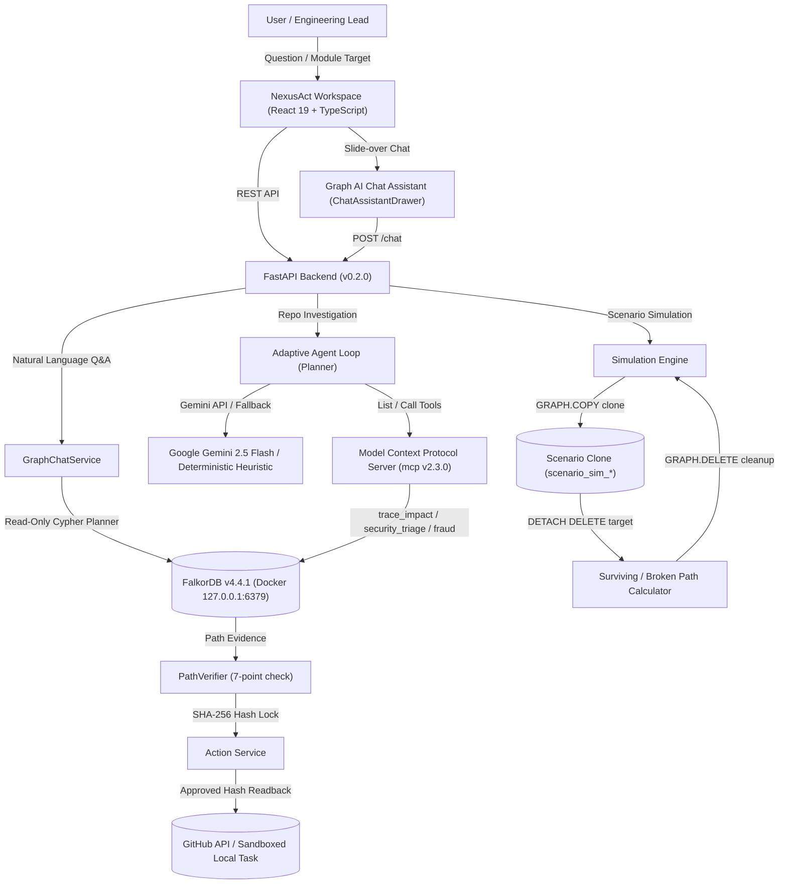

# NexusAct

**Graph-Native AI That Investigates, Simulates, and Acts**  
*Architecture: GraphAction Fabric (GAF)*

[](https://github.com/VishwanathArchakMR/NexusAct/actions/workflows/ci.yml)
[](https://www.falkordb.com/)
[](https://fastapi.tiangolo.com/)
[](https://modelcontextprotocol.io/)
[](https://react.dev/)
[](https://www.typescriptlang.org/)
[](https://opensource.org/licenses/MIT)
[](./tests)
[](./frontend/tests)

> **FalkorDB Hackathon Submission**  
> **Track:** *Agents That Act on Connected Data*  
> **Primary Database:** FalkorDB v4.4.1 (Redis Protocol / Cypher)  
> **Phase 23 Acceptance Matrix:** [`docs/PHASE23_ACCEPTANCE.md`](docs/PHASE23_ACCEPTANCE.md)  
> **Phase 23 Final Report:** [`docs/PHASE23_FINAL_REPORT.md`](docs/PHASE23_FINAL_REPORT.md)  
> **Phase 23 Baseline Audit:** [`docs/PHASE23_BASELINE.md`](docs/PHASE23_BASELINE.md)  
> **Hackathon Submission Checklist:** [`docs/SUBMISSION_CHECKLIST.md`](docs/SUBMISSION_CHECKLIST.md)  
> **Live Demo Walkthrough:** [`docs/DEMO_SCRIPT.md`](docs/DEMO_SCRIPT.md)  

---

## 1. Executive Summary

**NexusAct** is a graph-native AI engineering agent that investigates software repositories, dependency topologies, and connected data ecosystems as interactive, auditable knowledge graphs.

Unlike conventional chatbots that hallucinate codebase relationships from flat text embeddings, NexusAct grounds its reasoning directly in **FalkorDB v4.4.1**. It traverses live dependency paths, simulates counterfactual architectural changes in isolated sandbox clones, traces code author expertise through Git commit history, and allows developers to converse with connected graph data through an integrated, read-only AI chat assistant.

### Key Capabilities

1. **Interactive Counterfactual Scenario Simulation (Phase 23):**
   - Enables developers to excise any module from the dependency graph and simulate the blast radius.
   - Leverages FalkorDB's native `GRAPH.COPY` to create ephemeral scenario clones (`scenario_sim_<uuid>`), recalculating surviving vs. severed paths without mutating production graphs.
   - Provides honest, evidence-grounded zero-impact explanations for components with zero upstream callers.

2. **Contributor & Reviewer Intelligence (Phase 23):**
   - Discovers domain experts by traversing historical commit touch graphs: `(:Person)-[:AUTHORED]->(:Commit)-[:TOUCHES]->(:File)<-[:CONTAINS]-(:Module)`.
   - Distinguishes code authors from peer reviewers, disclosing missing review evidence transparently and ranking candidates via a weighted composite scoring formula.

3. **Graph-Grounded Right-Side AI Chat Assistant (Phase 23):**
   - A persistent, slide-over drawer (`ChatAssistantDrawer`) bound to the active repository graph.
   - Discovers FalkorDB graph schema on the fly, plans bounded read-only Cypher queries, strictly blocks mutating statements (`CREATE`, `MERGE`, `DELETE`, `DROP`), and renders live Cypher execution traces with millisecond latencies and clickable evidence navigation chips.

4. **Multi-Domain Graph Exploration:**
   - **Software Repository Domain:** AST dependency parsing (Python, TypeScript, JavaScript), reverse-impact blast radius, and structural PageRank centrality.
   - **Public Knowledge Domain (Mode A):** Bounded discovery across AI models and datasets (Hugging Face Hub), scholarly works (OpenAlex, Crossref), and topics (Wikidata) persisted idempotently in FalkorDB.
   - **Vulnerability Triage (OSV):** Correlates package manifests against the Open Source Vulnerabilities database and traces reachability to internal caller modules.
   - **Financial Fraud Investigation (Phase 21):** Isolated graph namespaces (`fin_<dataset_id>`) detecting multi-hop circular loops (3–5 hops), shared device/IP infrastructure, and risk scoring.

5. **Cryptographic Action Verification:**
   - Proposed actions (such as automated GitHub issues) generate canonical SHA-256 integrity locks. External mutations require explicit human approval and verified hash readbacks.

---

## 2. Technical Architecture: GraphAction Fabric (GAF)



---

## 3. Graph Data Models & Key Cypher Patterns

NexusAct maintains strict logical and physical graph isolation in FalkorDB:

### Core Schemas

- **Software Codebase Graphs (`nexusact_main`, `repo_*`):**
  - **Nodes:** `(:Module)`, `(:File)`, `(:Person)`, `(:Commit)`, `(:PackageDependency)`, `(:Vulnerability)`
  - **Relationships:**
    - `(:Module)-[:DEPENDS_ON]->(:Module)` (Canonical dependency direction)
    - `(:Module)-[:CONTAINS]->(:File)`
    - `(:Person)-[:AUTHORED]->(:Commit)`
    - `(:Commit)-[:TOUCHES]->(:File)`
    - `(:Module)-[:REQUIRES_PACKAGE]->(:PackageDependency)`
    - `(:PackageDependency)-[:HAS_VULNERABILITY]->(:Vulnerability)`

- **Financial Fraud Graphs (`fin_*`):**
  - **Nodes:** `(:Account)`, `(:Person)`, `(:Device)`, `(:IPAddress)`, `(:Merchant)`, `(:Transaction)`
  - **Relationships:** `(:Person)-[:OWNS]->(:Account)`, `(:Account)-[:SENDS_TO]->(:Account)`, `(:Account)-[:USES_DEVICE]->(:Device)`

### Essential Cypher Queries

1. **Reverse Impact Blast Radius Traversal:**
   ```cypher
   MATCH path = (caller:Module)-[:DEPENDS_ON*1..4]->(target:Module {id: $target_id})
   RETURN caller.id, caller.name, length(path) AS depth
   ORDER BY depth ASC
   ```

2. **Counterfactual Simulation via Isolated Clone (`GRAPH.COPY`):**
   ```cypher
   GRAPH.COPY nexusact_main scenario_sim_a1b2c3d4
   // In isolated clone:
   MATCH (m:Module {id: $target_id}) DETACH DELETE m
   // Recalculate broken and surviving paths from affected callers
   // Clone is guaranteed destroyed:
   GRAPH.DELETE scenario_sim_a1b2c3d4
   ```

3. **Contributor Expertise & File Touches:**
   ```cypher
   MATCH (p:Person)-[:AUTHORED]->(c:Commit)-[:TOUCHES]->(f:File)<-[:CONTAINS]-(m:Module)
   WHERE m.id = $module_id
   RETURN p.id, p.name, p.email, count(DISTINCT c) AS commits, count(DISTINCT f) AS files_touched, max(c.committed_at) AS last_touch
   ORDER BY commits DESC, files_touched DESC
   ```

4. **Chat Assistant Dynamic Schema Discovery:**
   ```cypher
   CALL db.labels()
   CALL db.relationshipTypes()
   MATCH (m:Module) RETURN count(m) AS module_count
   ```

---

## 4. Technology Stack & Verification Baseline

| Component | Technology | Version / Status |
|---|---|---|
| **Graph Database** | FalkorDB (Docker Container) | `v4.4.1` (Pinned) |
| **Backend Framework**| FastAPI, Pydantic v2, Uvicorn | `0.115+` / `2.14+` |
| **Language Runtime** | CPython managed via `uv` | `3.12.8` |
| **Tool Protocol** | Model Context Protocol (`mcp`) SDK | `2.3.0` |
| **Frontend UI** | React 19, TypeScript Strict, Vite | `19.2.8` / `6.0.2` / `8.3.4` |
| **LLM Provider** | Google Gemini 2.5 Flash / Deterministic Fallback | Official `google-genai` SDK |
| **Python Tests** | Pytest (Integration, Regression, Unit) | **162/162 passing** (66s) |
| **Frontend Tests**| Vitest (Testing Library, React 19) | **26/26 passing** (6s) |
| **Linters & Typers** | Ruff, Mypy, Oxlint | **0 errors, 0 warnings across all files** |

---

## 5. Quick Start & Local Run Commands

### 1. Prerequisites
- Docker Desktop with WSL2 integration (Windows) or native Docker (Linux/macOS)
- Python 3.12+ (uv recommended)
- Node.js 22+ and npm

### 2. Launch Local Environment (PowerShell)
```powershell
# 1. Start FalkorDB and verify Cypher socket readiness
.\scripts\start.ps1

# 2. Check service status
.\scripts\status.ps1
```

### 3. Ingest Local Codebase
```powershell
# Ingests AST modules, dependencies, and Git commit history into FalkorDB
.\scripts\ingest.ps1
```

### 4. Run the Full Quality Suite
```powershell
# Backend linter & type checks
.\.venv\Scripts\ruff.exe check .
.\.venv\Scripts\ruff.exe format --check backend tests mcp_server
.\.venv\Scripts\mypy.exe backend mcp_server

# Backend test suite (162 tests)
.\.venv\Scripts\pytest.exe -q

# Frontend checks & tests (26 tests)
cd frontend
npm run lint
npm test
npm run build
cd ..
```

### 5. Production Docker Compose Deployment
```powershell
# Validate compose configuration
docker compose -f docker-compose.prod.yml config

# Launch production stack (FalkorDB, FastAPI, Frontend on port 3000)
docker compose -f docker-compose.prod.yml up --build -d
```
Access the application at `http://localhost:3000`.

---

## 6. Security, Isolation & Safety Bounds

1. **Ephemeral Sandboxing:** Counterfactual simulations clone via `GRAPH.COPY` into random `scenario_sim_<uuid>` namespaces and delete them in guaranteed `finally` blocks.
2. **Read-Only Chat Cypher Enforcement:** The chat service strictly blocks mutating Cypher statements (`CREATE`, `MERGE`, `DELETE`, `SET`, `DROP`, `ALTER`, `CALL dbms.*`) and bounds graph traversal depth (`*1..3`).
3. **Cryptographic Action Binding:** Proposed GitHub issues calculate canonical SHA-256 hashes of their target entity, question, and action body.
4. **Transparent Degradation:** If `GEMINI_API_KEY` or `GITHUB_TOKEN` is unset, NexusAct operates with full deterministic graph intelligence and local saved states without fabricating fake responses.

---

## 7. AI-Assisted Development Disclosure

In accordance with hackathon rules:
- **Generative AI Usage:** Google Antigravity IDE agentic workflows and Gemini 2.5 Flash were utilized during development for interactive pair programming, test suite authoring, Cypher optimization, and documentation generation.
- **Human Authorship & Responsibility:** The system architecture (GraphAction Fabric), graph schemas, counterfactual simulation safety mechanisms, read-only Cypher query validation rules, and cryptographic approval pipelines were designed, reviewed, and verified by the author. Full responsibility for the codebase and submitted deliverables remains with the author.
