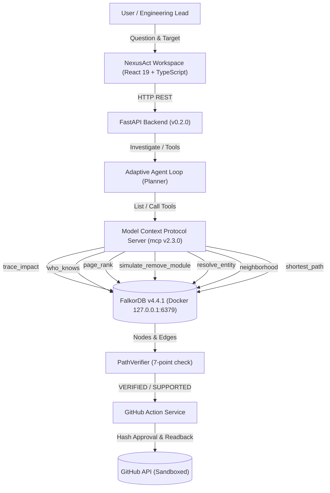

# NexusAct

**Graph-Native AI That Investigates, Simulates, and Acts**  
*Architecture: GraphAction Fabric (GAF)*

[](https://www.falkordb.com/)
[](https://fastapi.tiangolo.com/)
[](https://modelcontextprotocol.io/)
[](https://react.dev/)
[](https://www.typescriptlang.org/)
[](https://opensource.org/licenses/MIT)
[](./tests)
[](./frontend/tests)

---

## 1. Executive Summary

**NexusAct** is a graph-native AI engineering agent that investigates software repositories as connected graphs.

A user asks:
> *"If I change this module, which other modules may be affected, who has relevant experience, what happens if the module is removed in a simulated graph, and can you create an issue explaining the findings?"*

NexusAct executes this complete, end-to-end investigation:

1. **Repository Ingestion:** Ingests actual local or public GitHub repositories into FalkorDB via Python AST parsing and Git commit history.
2. **Reverse Impact Analysis (`trace_impact`):** Traverses upstream reverse-dependencies up to 4 hops (`DependentModule -[:DEPENDS_ON]-> DependencyModule`).
3. **Reviewer Discovery (`who_knows`):** Computes evidence-backed reviewer rankings with a transparent 4-part scoring formula (files touched, recency, ownership, peer reviews).
4. **Structural Centrality (`page_rank`):** Identifies structurally influential components using FalkorDB native PageRank (`CALL algo.pageRank('Module', 'DEPENDS_ON')`).
5. **Counterfactual Simulation (`simulate_remove_module`):** Clones the graph via `GRAPH.COPY`, removes the target module in the temporary copy, computes broken paths and blast radius score, and cleans up.
6. **Path Verification (`PathVerifier`):** Validates all paths, node/edge IDs, directions, and source file evidence against FalkorDB, emitting `VERIFIED`, `SUPPORTED`, `CONTRADICTED`, or `UNKNOWN`.
7. **Adaptive MCP Agent:** The agent discovers registered tools over MCP and adaptively selects tools based on intermediate findings, persisting `Investigation` and `ToolInvocation` records in FalkorDB.
8. **Interactive Frontend:** Renders real dependency graphs, agent tool execution traces, reviewer evidence, counterfactual before/after diffs, and issue proposals.
9. **Verified GitHub Action:** Generates issue proposals with canonical SHA-256 payload hash binding and idempotency markers (`<!-- GAF-ACTION-MARKER:<hash> -->`).
10. **Multi-Repository Support:** Register and isolate multiple local or public GitHub repositories into separate FalkorDB graphs (`repo_{slug}`).
11. **Natural Language Entity Resolution:** Resolves free-text module queries with ambiguity detection and candidate chips when multiple matches exist.

---

## 2. Technical Architecture: GraphAction Fabric (GAF)



### Graph Model & Canonical Semantics

- **Canonical Dependency Direction:** `(DependentModule)-[:DEPENDS_ON]->(DependencyModule)`. Reverse-impact analysis traverses upstream callers pointing to the target dependency.
- **Node Labels:** `Repository`, `Module`, `File`, `Person`, `Commit`, `Investigation`, `ToolInvocation`, `Scenario`, `ScenarioResult`, `Action`, `ActionOutcome`.
- **Relationship Types:** `DEPENDS_ON`, `CONTAINS`, `AUTHORED`, `TOUCHES`, `USED_TOOL`, `HAS_SCENARIO`, `CREATED_ACTION`, `HAS_OUTCOME`.
- **Evidence Provenance:** Edges store `evidence_type` (`observed`, `derived`, `inferred`), `source_file`, and commit references.

---

## 3. Technology Stack & Environment

| Component | Technology | Version |
|---|---|---|
| **Operating System** | Windows 11 with WSL2 runtime | - |
| **Graph Database** | FalkorDB (Docker Container) | `v4.4.1` (Pinned) |
| **Python** | CPython managed via `uv` | `3.12.8` |
| **Backend** | FastAPI, Pydantic v2, Uvicorn | `0.115+` / `2.14+` |
| **MCP SDK** | Official Python `mcp` SDK | `2.3.0` |
| **Frontend** | React, TypeScript, Vite, Lucide | `19.2.8` / `6.0.2` / `8.3.4` |
| **Local LLM** | Ollama (Local-first) / Heuristic Fallback | Configurable |
| **Quality Suite** | Pytest, Ruff, Mypy, Oxlint, Vitest | **62/62 python, 8/8 vitest — all clean** |

---

## 4. Quick Start & Local Run Commands

### 1. Prerequisites

- Docker Desktop with WSL2 integration (or bare WSL2 Docker daemon)
- Python 3.11+ with `uv` installed
- Node.js 22+

### 2. Start All Services

```powershell
# Starts FalkorDB, launches FastAPI backend (8000), and starts frontend (5173)
.\scripts\start.ps1
```

### 3. Ingest Repository into FalkorDB

```powershell
# Runs AST parser and Git history extractor on the local workspace
.\scripts\ingest.ps1
```

### 4. Run Quality & Validation Suite

```powershell
# Runs ruff, mypy, pytest (62 tests), oxlint, vitest (8 tests), and production build
.\scripts\check.ps1
```

### 5. Production Local Deployment (All Three Services via Docker)

```powershell
# Build and start all services with persistent storage
docker compose -f docker-compose.prod.yml up --build -d

# Access frontend at http://localhost:3000
```

### 6. Stop Local Services

```powershell
.\scripts\stop.ps1
```

---

## 5. Live Deployment Options

See [`docs/DEPLOYMENT.md`](docs/DEPLOYMENT.md) for a full, honest assessment of free-tier deployment options.

### Summary

| Option | Cost | Persistence | Verdict |
|---|---|---|---|
| **Local docker-compose.prod.yml** | Free | ✅ Full AOF persistence | ✅ Recommended |
| **FalkorDB Cloud Free + Render.com** | Free | ⚠️ Demo only (no backups) | ⚠️ Hackathon demo only |
| **Railway.app Trial** | $5 trial credit | ✅ 0.5 GB volume | ✅ Best live option |

> **Honest note:** A fully persistent, always-on deployment at true zero cost is not available because FalkorDB requires a stateful process. The local docker-compose approach is the most reliable option for demos and production.

---

## 6. Security & Isolation Guarantees

1. **Docker Daemon Security:** The Docker daemon running inside WSL2 binds to loopback-only (`127.0.0.1:2375`). Never exposed on `0.0.0.0`.
2. **Database Protection:** The primary graph (`nexusact_main`) is listed in `PROTECTED_GRAPHS`. Counterfactual simulations clone via `GRAPH.COPY` and strictly delete temporary clones in `finally` blocks.
3. **No Dynamic Cypher Injection:** All Cypher queries use parameterized inputs with typed Pydantic payloads.
4. **Action Approval Binding:** Issue proposals compute a canonical SHA-256 hash. External submission requires the exact approved hash.
5. **Idempotency Reconciliation:** Every proposed issue embeds a `<!-- GAF-ACTION-MARKER:<hash> -->` marker to prevent duplicates.
6. **Honest Fallback:** If Ollama or GitHub tokens are unconfigured, NexusAct operates with full local graph intelligence and previews without fabricating fake reviews or external states.
7. **TrustedHostMiddleware:** Enabled in `APP_ENV=production` to prevent Host header injection attacks.
8. **Non-root Docker containers:** Both backend and frontend containers run as a non-root `nexusact` system user.
9. **API Docs hidden in production:** Swagger UI and ReDoc are disabled when `APP_ENV=production`.
