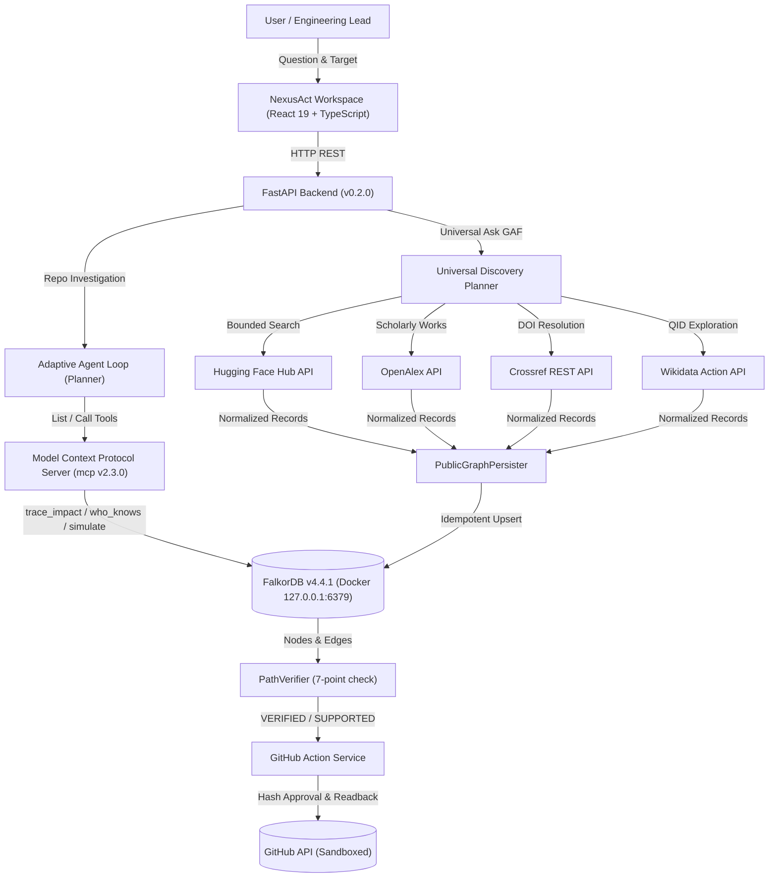

# NexusAct

**Graph-Native AI That Investigates, Simulates, and Acts**  
*Architecture: GraphAction Fabric (GAF)*

[](https://github.com/VishwanathArchakMR/NexusAct/actions/workflows/ci.yml)
[](https://www.falkordb.com/)
[](https://fastapi.tiangolo.com/)
[](https://modelcontextprotocol.io/)
[](https://react.dev/)
[](https://www.typescriptlang.org/)
[](https://opensource.org/licenses/MIT)
[](./tests)
[](./frontend/tests)

---

## 1. Executive Summary

**NexusAct** is a graph-native AI engineering agent that investigates software repositories and public knowledge ecosystems as connected graphs.

Built on the **GraphAction Fabric (GAF)** architecture, NexusAct operates across two first-class domains:
1. **Software Repository Domain:** AST dependency parsing, bounded reverse impact traversal, contributor expertise ranking, structural centrality (PageRank), counterfactual simulation with `GRAPH.COPY` isolation, and cryptographically verified GitHub action proposals.
2. **Universal Public-Data Domain (Phase 7):** Bounded discovery across AI models and datasets (Hugging Face Hub), scholarly publications and citations (OpenAlex, Crossref), and organizations, researchers, and topics (Wikidata). All records are persisted idempotently into FalkorDB with strict provenance tracing and evidence links.

---

## 2. Technical Architecture: GraphAction Fabric (GAF)



### Graph Model & Canonical Semantics

- **Canonical Dependency Direction:** `(DependentModule)-[:DEPENDS_ON]->(DependencyModule)`. Reverse-impact analysis traverses upstream callers pointing to the target dependency.
- **Node Labels:** `Repository`, `Module`, `File`, `Person`, `Commit`, `Model`, `Dataset`, `Paper`, `Organization`, `Topic`, `SourceRecord`, `Investigation`, `ToolInvocation`, `Scenario`, `ScenarioResult`, `Action`, `ActionOutcome`.
- **Relationship Types:** `DEPENDS_ON`, `CONTAINS`, `AUTHORED`, `TOUCHES`, `USES_DATASET`, `CITES`, `AFFILIATED_WITH`, `CREATED_BY`, `HAS_TOPIC`, `FUNDED_BY`, `SUPPORTED_BY`.
- **Evidence Provenance:** Edges store `evidence_type` (`observed`, `derived`, `inferred`), `source_file`, confidence (`EXACT`, `HIGH`, `SUPPORTED`), and source provenance URLs.

---

## 3. Technology Stack & Environment

| Component | Technology | Version |
|---|---|---|
| **Operating System** | Windows 11 with WSL2 runtime | - |
| **Graph Database** | FalkorDB (Docker Container) | `v4.4.1` (Pinned) |
| **Python** | CPython managed via `uv` | `3.12.8` |
| **Backend** | FastAPI, Pydantic v2, Uvicorn | `0.115+` / `2.14+` |
| **MCP SDK** | Official Python `mcp` SDK | `2.3.0` |
| **Frontend** | React, TypeScript, Vite, Lucide | `19.2.8` / `6.0.2` / `8.3.4` |
| **Public Connectors** | Hugging Face, OpenAlex, Crossref, Wikidata | Fixed API Constants |
| **Local LLM** | Ollama (Local-first) / Heuristic Fallback | Configurable |
| **Quality Suite** | Pytest, Ruff, Mypy, Oxlint, Vitest | **74/74 python, 8/8 vitest — all clean** |

---

## 4. Quick Start & Local Run Commands

### 1. Prerequisites

- Docker Desktop with WSL2 integration (or bare WSL2 Docker daemon)
- Python 3.11+ with `uv` installed
- Node.js 22+

### 2. Start All Services

```powershell
# Starts FalkorDB, launches FastAPI backend (8000), and starts frontend (5173)
.\scripts\start.ps1
```

### 3. Ingest Repository into FalkorDB

```powershell
# Runs AST parser and Git history extractor on the local workspace
.\scripts\ingest.ps1
```

### 4. Run Quality & Validation Suite

```powershell
# Runs ruff, mypy, pytest (62 tests), oxlint, vitest (8 tests), and production build
.\scripts\check.ps1
```

### 5. Production Local Deployment (All Three Services via Docker)

```powershell
# Build and start all services with persistent storage
docker compose -f docker-compose.prod.yml up --build -d

# Access frontend at http://localhost:3000
```

### 6. Stop Local Services

```powershell
.\scripts\stop.ps1
```

---

## 5. Live Deployment Options

See [`docs/DEPLOYMENT.md`](docs/DEPLOYMENT.md) for a full, honest assessment of free-tier deployment options.

### Summary

| Option | Cost | Persistence | Verdict |
|---|---|---|---|
| **Local docker-compose.prod.yml** | Free | ✅ Full AOF persistence | ✅ Recommended |
| **FalkorDB Cloud Free + Render.com** | Free | ⚠️ Demo only (no backups) | ⚠️ Hackathon demo only |
| **Railway.app Trial** | $5 trial credit | ✅ 0.5 GB volume | ✅ Best live option |

> **Honest note:** A fully persistent, always-on deployment at true zero cost is not available because FalkorDB requires a stateful process. The local docker-compose approach is the most reliable option for demos and production.

---

## 6. Security & Isolation Guarantees

1. **Docker Daemon Security:** The Docker daemon running inside WSL2 binds to loopback-only (`127.0.0.1:2375`). Never exposed on `0.0.0.0`.
2. **Database Protection:** The primary graph (`nexusact_main`) is listed in `PROTECTED_GRAPHS`. Counterfactual simulations clone via `GRAPH.COPY` and strictly delete temporary clones in `finally` blocks.
3. **No Dynamic Cypher Injection:** All Cypher queries use parameterized inputs with typed Pydantic payloads.
4. **Action Approval Binding:** Issue proposals compute a canonical SHA-256 hash. External submission requires the exact approved hash.
5. **Idempotency Reconciliation:** Every proposed issue embeds a `<!-- GAF-ACTION-MARKER:<hash> -->` marker to prevent duplicates.
6. **Honest Fallback:** If Ollama or GitHub tokens are unconfigured, NexusAct operates with full local graph intelligence and previews without fabricating fake reviews or external states.
7. **TrustedHostMiddleware:** Enabled in `APP_ENV=production` to prevent Host header injection attacks.
8. **Non-root Docker containers:** Both backend and frontend containers run as a non-root `nexusact` system user.
9. **API Docs hidden in production:** Swagger UI and ReDoc are disabled when `APP_ENV=production`.

---

## 7. Verification Reports & Demonstration

- **Live Demonstration Guide:** [`docs/DEMO_SCRIPT.md`](docs/DEMO_SCRIPT.md) — Step-by-step reproducible live demo script.
- **Phase 6 Release Verification Report:** [`docs/PHASE6_RELEASE_REPORT.md`](docs/PHASE6_RELEASE_REPORT.md) — Audit trail, CI specifications, test verification, and commit reconciliation.
- **Deployment Guide:** [`docs/DEPLOYMENT.md`](docs/DEPLOYMENT.md) — Production Compose and cloud hosting analysis.

