# NexusAct (GraphAction Fabric) — Complete System Architecture

**Project:** NexusAct — Graph-Native AI That Investigates, Simulates, and Acts  
**Competition Track:** Agents That Act on Connected Data  
**Primary Graph Database:** FalkorDB v4.4.1 (Redis protocol, Cypher query engine)  
**Document Revision:** Phase 24 Baseline Verified  
**Date:** 2026-10-18  

---

## 1. Executive Summary & Purpose

NexusAct is an autonomous engineering agent designed to investigate software dependency structures, Git commit history, vulnerability chains, and connected financial networks as rich, native graphs.

Instead of relying on flat keyword or vector search that hallucinates connections, NexusAct uses **FalkorDB v4.4.1** as its central reasoning engine. It executes graph traversals, isolated counterfactual simulations, reviewer ranking algorithms, and safe Cypher-grounded question answering with real returned row evidence.

---

## 2. End-to-End System Architecture

The following diagram represents the actual implemented architecture of NexusAct, illustrating the exact request lifecycles, selected source registry, isolated scenario graphs, direct Cypher execution vs MCP tools, and the LLM-to-FalkorDB grounded loop:

```mermaid
flowchart TD
    subgraph Frontend["React 19 Frontend (TypeScript + Vite)"]
        UI["NexusAct Workspace"]
        Drawer["Graph AI Chat Drawer (Right-Side)"]
        SimPanel["Scenario Simulation Panel"]
        RevPanel["Reviewers & Authors Panel"]
        CodePanel["Code Inspector & AST Tree"]
        FraudPanel["Financial Fraud Investigation"]
    end

    subgraph Backend["FastAPI Backend Service (:8000)"]
        Router["API Router (/api/v1)"]
        Registry["Trusted Source & Dataset Registry"]
        ChatService["GraphChatService"]
        AgentLoop["Adaptive Investigation Agent"]
        SimEngine["Scenario Simulation Engine"]
        IngestEngine["AST & Git Ingestion Pipeline"]
        FinanceEngine["Financial Normalization & Ingestion"]
        ActionService["Verified Action Service (SHA-256 Lock)"]
    end

    subgraph LLM_Subsystem["LLM Intelligence & Planning"]
        Provider["Google Gemini 2.5 Flash / Deterministic Fallback"]
        CypherValidator["Read-Only Cypher Safety Validator"]
    end

    subgraph FalkorDB_Engine["FalkorDB Graph Database (:6379)"]
        BaseGraph[("Base Graph: nexusact_main / repo_*")]
        EphemeralClone[("Ephemeral Scenario Clone: scen_*")]
        FinGraph[("Isolated Financial Graph: fin_*")]
    end

    subgraph Ext_Tools["MCP & External Services"]
        MCP["Model Context Protocol Server (mcp v2.3)"]
        OSV["OSV.dev Vulnerability API"]
        GitRemote["GitHub API (Human-Approved Issues)"]
    end

    %% User Interactions
    UI --> Router
    Drawer -->|POST /investigation/chat| ChatService
    SimPanel -->|POST /investigation/simulate| SimEngine
    RevPanel -->|GET /investigation/reviewers| Router
    CodePanel -->|GET /ingest/file-content| IngestEngine
    FraudPanel -->|POST /finance/investigate| FinanceEngine

    %% Source Registry Resolution
    ChatService --> Registry
    SimEngine --> Registry
    FinanceEngine --> Registry
    Registry -.->|Authoritative Graph Name & Revision| FalkorDB_Engine

    %% Graph AI Chat Grounded Lifecycle
    ChatService -->|1. Request Dynamic Schema| BaseGraph
    BaseGraph -->|2. Labels & Rel Types| ChatService
    ChatService -->|3. Question + Schema Prompt| Provider
    Provider -->|4. Generate Cypher Query| CypherValidator
    CypherValidator -->|5. Block Mutations / Verify Read-Only| BaseGraph
    BaseGraph -->|6. Real Evidence Rows & Paths| ChatService
    ChatService -->|7. Grounded Answer Prompt + Evidence| Provider
    Provider -->|8. Natural Language Synthesis| ChatService
    ChatService -->|9. Answer + Trace + Evidence Chips| Drawer

    %% Scenario Simulation Isolation Flow
    SimEngine -->|1. GRAPH.COPY BaseGraph EphemeralClone| BaseGraph
    BaseGraph --> EphemeralClone
    SimEngine -->|2. DETACH DELETE Target Module| EphemeralClone
    EphemeralClone -->|3. Measure Severed & Surviving Paths| SimEngine
    SimEngine -->|4. GRAPH.DELETE EphemeralClone| EphemeralClone
    SimEngine -->|5. Base Graph 100% Preserved| BaseGraph

    %% Agent Loop and MCP
    Router --> AgentLoop
    AgentLoop --> MCP
    MCP --> OSV
    MCP --> BaseGraph

    %% Action Verification
    AgentLoop --> ActionService
    ActionService -->|Human Hash Approval| GitRemote
```



---

## 3. Real Graph-Grounded LLM Reasoning Flow

A critical architectural distinction in NexusAct is the real connection between the LLM and FalkorDB. The assistant does **not** hallucinate code architecture from generic memory:

```
+-----------------------------------------------------------------------------------------+
|                               GRAPH AI CHAT LIFECYCLE                                    |
+-----------------------------------------------------------------------------------------+
|                                                                                         |
|  1. User asks question in right-side assistant drawer                                   |
|     └─> Request: POST /api/v1/investigation/chat { question, repo_id, graph_name }      |
|                                                                                         |
|  2. Backend resolves authoritative source context via Trusted Source Registry           |
|     └─> Resolves canonical graph_name and ingested commit revision                      |
|                                                                                         |
|  3. Schema discovery from FalkorDB                                                      |
|     └─> CALL db.labels() and CALL db.relationshipTypes()                                |
|                                                                                         |
|  4. LLM Planning Phase                                                                  |
|     └─> Gemini 2.5 Flash receives user prompt + verified schema definitions             |
|     └─> Emits candidate read-only Cypher query with entity parameterization             |
|                                                                                         |
|  5. AST Cypher Safety & Boundary Verification                                           |
|     └─> Rejects CREATE, MERGE, DELETE, SET, DROP, ALTER, CALL dbms.*                    |
|     └─> Enforces bounded traversal depths (*1..3) and row limits (LIMIT 50)             |
|                                                                                         |
|  6. Execution against resolved FalkorDB namespace                                       |
|     └─> FalkorDB Cypher Engine runs query; returns real node/edge rows and latencies    |
|                                                                                         |
|  7. Grounded Answer Synthesis                                                           |
|     └─> LLM synthesizes natural-language response strictly citing returned evidence     |
|     └─> If zero rows return, honestly reports "No evidence found in graph"              |
|                                                                                         |
|  8. Response Delivery                                                                   |
|     └─> Returns markdown answer, execution duration (ms), executed Cypher, and          |
|         navigable evidence chips linking to GraphCanvas, CodeInspector, or Reviewers    |
|                                                                                         |
+-----------------------------------------------------------------------------------------+
```

---

## 4. Graph Schemas & Canonical Edge Directions

### 4.1 Software Engineering Graph (`nexusact_main`, `repo_*`)
All relationships use canonical dependency and containment directions:
- `(:Module)-[:DEPENDS_ON]->(:Module)`: Directed import relationship (`caller -DEPENDS_ON-> dependency`).
- `(:Module)-[:CONTAINS]->(:File)`: Module to physical disk file linkage.
- `(:Person)-[:AUTHORED]->(:Commit)`: Contributor commit authorship.
- `(:Commit)-[:TOUCHES]->(:File)`: Files modified in a commit changeset.
- `(:Person)-[:REVIEWS]->(:Commit)`: Peer review metadata (when PR data exists).
- `(:Module)-[:REQUIRES_PACKAGE]->(:PackageDependency)`: Third-party package requirement.
- `(:PackageDependency)-[:HAS_VULNERABILITY]->(:Vulnerability)`: Reachable OSV vulnerability.

### 4.2 Financial Fraud Network (`fin_*`)
Isolated graph namespaces partitioned per dataset:
- `(:Account)-[:SENDS_TO {amount, timestamp, tx_id}]->(:Account)`: Directed monetary transactions.
- `(:Account)-[:USES_DEVICE]->(:Device)`: Device hardware fingerprint binding.
- `(:Account)-[:LOGS_FROM_IP]->(:IPAddress)`: Client IP network binding.
- `(:Account)-[:PAYS_MERCHANT]->(:Merchant)`: Commercial destination.

---

## 5. Ephemeral Counterfactual Scenario Simulation

```
Production Graph (nexusact_main) ────[GRAPH.COPY]────> Ephemeral Clone (scenario_sim_x7f2)
                                                                 │
                                                       [DETACH DELETE target]
                                                                 │
                                                    [Evaluate Impacted Callers]
                                                    [Compare Before/After Paths]
                                                                 │
Production Graph UNTOUCHED <────[GRAPH.DELETE]────────[Destroy Scenario Clone]
```

1. **Isolation Guarantee:** Simulations never execute mutating queries on the base graph.
2. **Ephemeral Lifecycle:** `GRAPH.COPY` duplicates the active graph into a unique namespace. After computing paths, `GRAPH.DELETE` is called within a `finally` block, ensuring zero resource leakage.
3. **Truthful Zero-Impact Reporting:** If a module has no upstream callers (`in_degree = 0`), the engine honestly returns a zero-blast-radius result with an explicit architectural explanation rather than fabricating an artificial impact.

---

## 6. Reviewers & Contributor Expertise Engine

Expertise is mathematically grounded in Git commit history using the schema:
`(:Person)-[:AUTHORED]->(:Commit)-[:TOUCHES]->(:File)<-[:CONTAINS]-(:Module)`

### Weighted Ranking Formula:
```
Composite Score = 0.40 * files_touched + 0.30 * recency + 0.20 * ownership + 0.10 * reviews
```
- **Files Touched (40%):** Breadth of modified files within target module boundaries.
- **Recency (30%):** Exponential decay based on days since last recorded commit.
- **Ownership (20%):** Proportion of total commits to target module authored by the candidate.
- **Reviews (10%):** Peer-review participation (disclosed as missing when unavailable in Git history).

---

## 7. Financial Ingestion & Provenance Architecture

To prevent generic labels, unidentified graphs, or uncalibrated fraud claims:
1. **Isolated Namespaces:** Each uploaded CSV or synthetic benchmark receives a dedicated FalkorDB graph (`fin_<dataset_id>`).
2. **Persistent Lineage Metadata:** Tracked in `FinancialDatasetMetadata`:
   - `dataset_id`, `dataset_name`, `filename`, `source_type`, `source_hash`
   - `created_at`, `imported_at`, `total_rows`, `accepted_rows`, `rejected_rows`
   - `graph_name`, `accounts_count`, `transactions_count`, `devices_count`, `ip_addresses_count`
   - `is_synthetic`: Boolean explicitly declaring whether the dataset is an AML benchmark or real user data.
   - `has_ground_truth_labels`: Distinguishes benchmark ground-truth from heuristic topological detection.
3. **Multi-Hop Traversal Algorithms:**
   - Circular routing traversal: `MATCH path = (a:Account)-[:SENDS_TO*3..5]->(a) RETURN path`
   - Shared entity infrastructure: `MATCH (a1:Account)-[:USES_DEVICE]->(d:Device)<-[:USES_DEVICE]-(a2:Account)`
4. **Strict Read-Only Execution:** Financial analysis is strictly read-only. No monetary balance, transaction, or account states can be altered.

---

## 8. Security Boundaries & Failure Recovery

| Boundary | Mechanism | Enforcement |
|---|---|---|
| **Graph Mutation** | Read-Only Cypher Planner & Regex Barrier | Rejects `CREATE`, `MERGE`, `DELETE`, `SET`, `DROP` with 400 Bad Request |
| **Public Demo Guard** | Server-Side `PUBLIC_DEMO_MODE` Flag | Returns 403 Forbidden for repo cloning, file uploads, and external GitHub actions |
| **Cross-Graph Leakage** | Authoritative Source Registry | Backend resolves graph names from trusted IDs; client cannot inject graph names |
| **Action Execution** | SHA-256 Cryptographic Hash Lock | External actions require manual approval and match payload hash exactly |
| **LLM Disconnection** | Deterministic Graph Fallback | Degrades gracefully to Cypher template grounding; never returns fabricated answers |
| **Cross-Language Code Inspection** | FalkorDB `m.path` resolution & extension probe | Probes `.tsx`, `.ts`, `.py`, `.json` against repo root; prevents false 404s |
| **Network Exposure** | Internal Bridge Network & Caddy Ingress | Only Caddy publishes 80/443; FalkorDB (6379) and FastAPI (8000) remain strictly private |

---

## 9. Production Deployment Topology (Always Free Fit)

In production deployments, NexusAct runs as a single-VM Docker Compose stack fronted by Caddy:
- **Caddy Ingress Container:** Listens on public HTTP (80) and HTTPS (443), managing automatic TLS certificates via Let's Encrypt.
- **Frontend Container:** Serves the compiled React 19 SPA through Nginx on internal port 80.
- **Backend Container:** Hosts the FastAPI application and MCP server on internal port 8000. Proxied by Caddy under `/api/*`, `/health`, and `/ready`.
- **FalkorDB Container:** Graph database running on internal port 6379 with persistent named volume `nexusact_falkordb_data` mounted at `/data` and append-only file (AOF) persistence.
- **Zero Paid Cloud Dependencies:** Designed to operate entirely within the Oracle Cloud Infrastructure Always Free tier (Ampere A1 Arm64 or AMD64 Micro).

