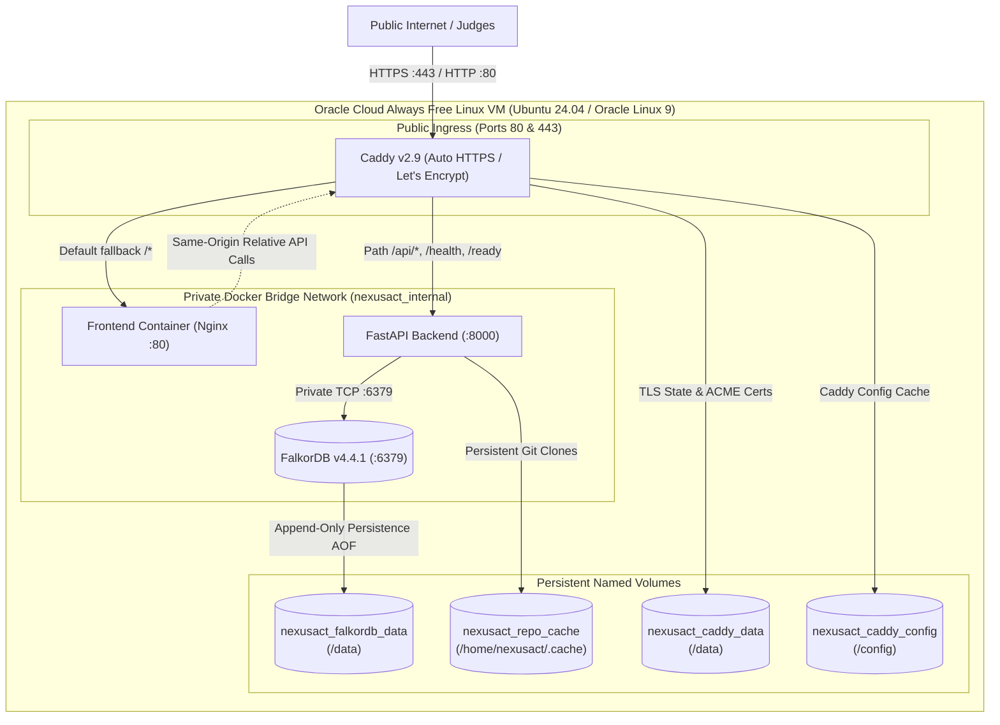

# NexusAct — Zero-Cost Cloud Deployment Plan

**Project:** NexusAct — Graph-Native AI That Investigates, Simulates, and Acts  
**Architecture:** GraphAction Fabric (GAF)  
**Target Platform:** Oracle Cloud Infrastructure (OCI) Always Free Tier (or equivalent free Linux VM)  
**Deployment Model:** Single-VM Docker Compose with Caddy Reverse Proxy & Persistent FalkorDB Volume  
**Status:** Prepared & Locally Validated — **Not Deployed in Phase 25**  
**Estimated Monthly Cost:** **$0.00 / month** (100% Always Free)  

---

## 1. Architectural Fit & Hosting Selection

NexusAct consists of four tightly-coupled components:
1. **FalkorDB v4.4.1** (low-latency in-memory graph database with append-only persistence).
2. **FastAPI Application** (Python 3.12 async backend + Cypher investigation planner + MCP server).
3. **React 19 SPA** (TypeScript + Tailwind/Vanilla CSS compiled static bundle served via Nginx).
4. **Caddy Reverse Proxy** (automatic TLS certificate management, public HTTP/HTTPS ingress, and same-origin API proxying).

### Why OCI Always Free Ampere A1?
- **Compute:** Oracle provides up to 4 Arm-based Ampere A1 cores and 24 GB of RAM free forever. A single instance configured with 2 OCPU and 12 GB RAM provides abundant headroom for in-memory graph algorithms, AST parsing, and concurrent chat investigations.
- **Multi-Arch Docker Images:** FalkorDB (`falkordb/falkordb:v4.4.1`), Python 3.12, Node 22, Nginx, and Caddy all provide official, native `linux/arm64` manifests.
- **Storage:** 200 GB of free persistent block storage, more than sufficient for persistent graph databases (`nexusact_falkordb_data`) and Git repository caches (`nexusact_repo_cache`).
- **Cost:** $0.00 lifetime without trial expiration.
- **Alternative Fallback:** If OCI Ampere A1 capacity is temporarily unavailable in a given home region, any standard x86_64 Linux VM (e.g., OCI AMD64 Micro, AWS EC2 t4g/t2.micro, or a Hetzner free trial) runs the identical Docker Compose stack without modification.

---

## 2. Production Topology & Network Isolation



### Strict Network Security Rules
- **No Direct Database Exposure:** FalkorDB port `6379` has no published host port. It is strictly accessible over `nexusact_internal` by the FastAPI backend.
- **No Direct Backend Exposure:** FastAPI port `8000` has no published host port. Caddy mediates all traffic, applying reverse-proxy headers and gzip/zstd compression.
- **Single Public Surface:** Only Caddy exposes port `80` (HTTP challenge / redirect) and port `443` (TLS traffic).

---

## 3. Same-Origin API Strategy & Reverse Proxy Routing

In production, frontend clients do not query a hardcoded `http://localhost:8000`. The frontend is compiled with relative API paths (`/api/v1/...`):
- `GET /health` → proxied to `backend:8000/health`
- `GET /ready` → proxied to `backend:8000/ready`
- `GET /api/*` → proxied to `backend:8000/api/*`
- `GET /*` → routed to `frontend:80/*` (Nginx serving `index.html` with SPA client-side fallback)

This guarantees zero CORS errors and avoids exposing internal backend ports.

---

## 4. Public Demo Mode & Abuse Prevention

Because NexusAct in development allows cloning arbitrary public repositories and uploading transaction CSVs, deploying a public instance without authentication poses resource-exhaustion risks.

To address this, NexusAct includes a server-side **`PUBLIC_DEMO_MODE=true`** flag:
1. **Repository Ingestion Disabled:** `POST /api/v1/ingest`, `POST /api/v1/ingest/register`, and `POST /api/v1/ingest/clone-and-ingest` return HTTP 403 Forbidden with a clear message directing the user to preloaded graphs.
2. **Financial File Uploads Disabled:** `POST /api/v1/finance/preview` and `POST /api/v1/finance/ingest` return HTTP 403 Forbidden. The preloaded synthetic AML benchmark dataset (`fin_aml_benchmark`) remains fully interactive.
3. **External Actions Gated:** `POST /api/v1/action/execute` returns HTTP 403 Forbidden, preventing unvetted issues from being filed to external GitHub repositories while keeping internal action review and hash verification fully functional.
4. **Interactive Read-Only Intelligence Retained:**
   - Interactive 2D Graph Explorer.
   - Code Inspector & Project Explorer file tree for the preloaded repository.
   - Scenario Simulation on isolated `scen_*` ephemeral graph clones.
   - Reviewers & Authors expertise ranking from ingested Git history.
   - Graph AI Chat with read-only Cypher generation and grounded evidence synthesis.
   - Financial graph cycle detection and shared device clustering.

---

## 5. Persistence, Backup, and Recovery

### FalkorDB Persistence Configuration
The FalkorDB container is configured with:
```yaml
environment:
  - BROWSER=0
  - REDIS_ARGS=--appendonly yes --appendfsync everysec
volumes:
  - nexusact_falkordb_data:/data
```
- Every write, node insertion, and edge creation is logged to an Append-Only File (AOF) on disk.
- Container restarts, image updates, or VM reboots do not lose graph state.

### Safe Backup Command
```bash
# Execute on the VM:
docker compose -f docker-compose.prod.yml exec falkordb redis-cli BGSAVE
docker compose -f docker-compose.prod.yml exec falkordb redis-cli BGREWRITEAOF
# Archive the volume directory
tar -czvf nexusact_graph_backup_$(date +%Y%m%d_%H%M%S).tar.gz /var/lib/docker/volumes/nexusact_falkordb_data/_data
```

### Safe Restore Command
```bash
# Stop services
docker compose -f docker-compose.prod.yml stop falkordb
# Extract backup archive into volume directory
tar -xzvf <backup_file>.tar.gz -C /var/lib/docker/volumes/nexusact_falkordb_data/_data
# Restart FalkorDB
docker compose -f docker-compose.prod.yml start falkordb
```

---

## 6. Step-by-Step Manual Deployment Procedure (For Subsequent Phase)

> **IMPORTANT:** Do NOT perform these steps during Phase 25. These steps are verified and ready for execution when the user initiates Phase 26.

### Step 1: Provision Oracle Cloud Always Free VM
1. Log into OCI Console (`cloud.oracle.com`).
2. Navigate to **Compute** → **Instances** → **Create Instance**.
3. Select **Image:** Ubuntu 24.04 LTS (Minimal or standard) or Oracle Linux 9.
4. Select **Shape:** `VM.Standard.A1.Flex` (Ampere), configure **2 OCPU** and **12 GB RAM**.
5. Under **Networking**, create/select a VCN with a public subnet and assign a public IPv4 address.
6. Add your public SSH key.
7. Under **Security Lists** for the subnet, ensure Ingress Rules permit:
   - Port 22 (SSH)
   - Port 80 (HTTP)
   - Port 443 (HTTPS)
8. Click **Create** and note the assigned public IP (e.g., `150.136.x.x`).

### Step 2: Configure Free DNS (e.g. DuckDNS)
1. Go to [duckdns.org](https://www.duckdns.org) and log in.
2. Create a domain (e.g. `nexusact.duckdns.org`).
3. Set the IP address to your VM's public IP.

### Step 3: Install Docker & Git on VM
SSH into the instance:
```bash
ssh -i ~/.ssh/id_rsa ubuntu@<VM_PUBLIC_IP>
```
Run installation:
```bash
sudo apt update && sudo apt install -y git curl ca-certificates
# Install Docker via official script
curl -fsSL https://get.docker.com -o get-docker.sh
sudo sh get-docker.sh
sudo usermod -aG docker $USER
newgrp docker
# Verify installation
docker compose version
```

### Step 4: Clone Repository & Configure Environment
```bash
git clone https://github.com/VishwanathArchakMR/NexusAct.git
cd NexusAct

# Create production environment file
cp .env.example .env.prod
```
Edit `.env.prod` with `nano .env.prod`:
```ini
APP_ENV=production
PUBLIC_DEMO_MODE=true
DOMAIN=nexusact.duckdns.org

# FalkorDB settings
FALKORDB_HOST=falkordb
FALKORDB_PORT=6379
FALKORDB_PRIMARY_GRAPH=nexusact_main

# LLM Configuration (Set your Gemini key if enabling AI chat)
LLM_PROVIDER=gemini
GEMINI_API_KEY=<YOUR_REAL_GEMINI_API_KEY>
GOOGLE_API_KEY=<YOUR_REAL_GEMINI_API_KEY>
GEMINI_MODEL=gemini-2.5-flash

# GitHub Token (Optional)
GITHUB_TOKEN=
```

### Step 5: Validate Configuration & Launch Services
```bash
# Check effective compose configuration
docker compose --env-file .env.prod -f docker-compose.prod.yml config

# Build and start all 4 services in detached mode
docker compose --env-file .env.prod -f docker-compose.prod.yml up --build -d
```

### Step 6: Verify Service Health
```bash
# Watch container startup
docker compose -f docker-compose.prod.yml ps

# Tail logs
docker compose -f docker-compose.prod.yml logs -f caddy backend falkordb
```

### Step 7: Bootstrap Initial Public Demo Graph
Execute the ingestion script to bootstrap the public NexusAct codebase and the AML transaction benchmark:
```bash
# Temporarily run ingestion inside the container
docker compose -f docker-compose.prod.yml exec backend python -c "
from backend.app.graph.client import graph_client
from backend.app.ingestion.engine import RepositoryIngestionEngine
engine = RepositoryIngestionEngine(graph_client)
report = engine.ingest('.', graph_name='nexusact_main')
print('Bootstrap complete:', report)
"

# Load the synthetic AML benchmark
curl -X POST http://localhost:8000/api/v1/finance/load-sample
```

### Step 8: Verify Public HTTPS in Browser
Navigate to `https://nexusact.duckdns.org`.
- Confirm SSL padlock icon (issued by Let's Encrypt via Caddy).
- Verify Graph Explorer renders nodes and edges.
- Verify Scenario Simulation executes.
- Verify Graph AI Chat responds with grounded graph evidence.
- Verify that attempting to upload an unauthorized file or ingest an external repository returns HTTP 403 Forbidden.
