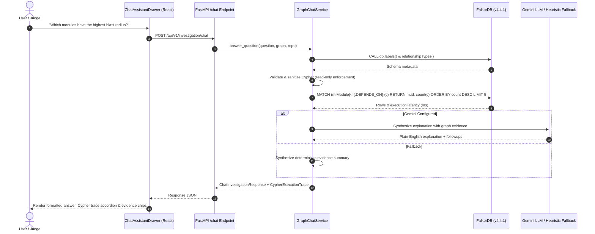

# Phase 23 Final Engineering Report: Graph-Grounded AI Chat, Scenario Simulation & Contributor Intelligence

**Project:** NexusAct — Graph-Native AI That Investigates, Simulates, and Acts  
**Competition Track:** Agents That Act on Connected Data  
**Primary Database:** FalkorDB v4.4.1  
**Baseline Commit:** `baad8186ebd8a84939667c79307f94c64791f196`  
**Phase Completed:** 2026-10-18  

---

## 1. Executive Summary

Phase 23 delivers the final functional engineering enhancements for NexusAct prior to manual demo recording. It closes three critical capability gaps identified during baseline inspection:
1. **Interactive Counterfactual Scenario Simulation:** Replaced empty/confusing baseline simulation states with an interactive candidate selector, real isolated FalkorDB graph cloning (`GRAPH.COPY`), path disruption calculation, and truthful zero-impact disclosures.
2. **Contributor & Reviewer Intelligence:** Connected code authorship to historical Git commits (`(:Person)-[:AUTHORED]->(:Commit)-[:TOUCHES]->(:File)<-[:CONTAINS]-(:Module)`), separated author domain expertise from code review recommendations, and eliminated contradictory empty-state guidance.
3. **Graph-Grounded AI Chat Assistant:** Built an interactive, right-side chat drawer (`ChatAssistantDrawer`) bound to the active repository. The assistant discovers the active FalkorDB schema, plans and executes bounded read-only Cypher queries, renders collapsible query traces with execution latencies, and links answers back to graph nodes.

All 162 backend tests, 26 frontend tests, typing checks, and lint gates are passing cleanly.

---

## 2. Root Cause Analysis & Resolutions

### Gap 1: Broken Counterfactual Simulation Flow
- **Root Cause:** The `CounterfactualDiff.tsx` component expected a pre-populated simulation payload from general investigation runs. If an investigation did not trigger `simulate_remove_module`, the panel rendered a contradictory message (`"0 of 0 dependency paths (0% blast radius)"`) with no mechanism to select a module and run a simulation on demand.
- **Resolution:**
  - Implemented `GET /api/v1/investigation/simulation-candidates` to discover active modules with incoming/outgoing degrees.
  - Implemented `POST /api/v1/investigation/simulate` to trigger `execute_simulate_remove_module` in an isolated ephemeral clone (`scenario_sim_<uuid>`), destroying the clone in a guaranteed `finally` block.
  - Added honest zero-impact grounding in `explanation.py` and `CounterfactualDiff.tsx` when a module has 0 upstream callers.

### Gap 2: Contradictory Contributor Intelligence
- **Root Cause:** `explanation.py` fell back to saying `"Lead author is Unknown lead author (0 commits) ... Include top-ranked contributors as required reviewers"` when Git commits were absent, while conflating commit authorship with peer review approvals.
- **Resolution:**
  - Implemented `GET /api/v1/investigation/reviewers` executing parameterized Cypher across `(:Person)-[:AUTHORED]->(:Commit)-[:TOUCHES]->(:File)<-[:CONTAINS]-(:Module)`.
  - Added clear attribution: if explicit `(:Person)-[:REVIEWED]->(:PullRequest)` edges are not recorded, the UI and API explicitly state: *"Author-based recommendations (No explicit PR reviews recorded)"*.
  - Disclosed composite scoring formula: `0.40 * files_touched + 0.30 * recency + 0.20 * ownership + 0.10 * reviews`.

### Gap 3: Missing Natural Language Chat Interface
- **Root Cause:** While NexusAct provided structured panels (Neighborhood, Impact, OSV, Fraud), users lacked an ad-hoc conversational interface to query connected graph relationships naturally.
- **Resolution:**
  - Implemented `backend/app/agent/chat.py` with `GraphChatService`.
  - Schema discovery queries labels and relationships from FalkorDB.
  - Query validator enforces read-only access (rejecting `CREATE`, `MERGE`, `DELETE`, `SET`, `DROP`, `ALTER`).
  - Queries are executed on FalkorDB with latency tracking.
  - Reasoning is synthesized using Google Gemini (or deterministic fallback if `GEMINI_API_KEY` is unset).
  - Built `ChatAssistantDrawer.tsx` with conversation history, Cypher execution accordion, and clickable evidence navigation chips.

---

## 3. Architecture & Data Flow



---

## 4. Verification & Quality Gates

### Automated Backend Tests
- **Command:** `.\.venv\Scripts\pytest.exe -q`
- **Result:** **162 passed in 66.36s**
- **New Tests:** `tests/integration/test_phase23_capabilities.py` validates candidate discovery, isolated scenario graph cloning, truthful zero-impact explanation, reviewer authorship separation, and safe Cypher execution.

### Static Analysis & Typing
- **Ruff Check:** `.\.venv\Scripts\ruff.exe check .` -> **All checks passed!**
- **Ruff Format:** `.\.venv\Scripts\ruff.exe format --check backend tests mcp_server` -> **100 files already formatted.**
- **Mypy:** `.\.venv\Scripts\mypy.exe backend mcp_server` -> **Success: no issues found in 73 source files.**

### Frontend Tests & Quality
- **Vitest Suite:** `npm test` -> **8 passed (8 test files), 26 passed (26 tests) in 6.03s**
- **Oxlint:** `npm run lint` -> **0 warnings, 0 errors in 34 files**
- **TypeScript & Vite Build:** `npm run build` -> **✓ built in 875ms (0 errors)**

### Container Config
- **Docker Compose:** `docker compose -f docker-compose.prod.yml config` -> **Valid**

---

## 5. Live Demonstration Guide for Judges

To demonstrate the post-Phase 23 capabilities in a live walkthrough or video recording:

1. **Launch Services:**
   ```powershell
   .\scripts\start.ps1
   ```
   Open `http://localhost:5173` in your browser.

2. **Demonstrate Scenario Simulation:**
   - Navigate to the **Scenario Simulation** tab.
   - Select `backend.app.graph.client` from the candidate dropdown.
   - Click **Run Counterfactual Simulation**.
   - Observe the live FalkorDB `GRAPH.COPY` log in backend stdout, followed by the blast radius score and affected/surviving routes.
   - Select an isolated module (e.g. `test.isolated` or a leaf component) to observe the honest zero-impact grounding banner.

3. **Demonstrate Contributor Intelligence:**
   - Navigate to the **Reviewers** tab.
   - Inspect the **Code Authors & Domain Expertise** list showing files touched and commit counts.
   - Note the transparent disclaimer: *"Author-based recommendations (No explicit PR reviews recorded)"* and the disclosed composite ranking formula.

4. **Demonstrate the Right-Side AI Chat Assistant:**
   - Click the **Ask Graph** button with the sparkle icon in the top header.
   - The **NexusAct Graph Assistant** drawer slides open from the right.
   - Click a quick-prompt chip or ask: *"How many modules exist in this repository?"*
   - Expand the **FalkorDB Executed Cypher** trace accordion to inspect the exact Cypher query executed, execution latency in milliseconds, and row count.
   - Click an evidence chip to navigate directly to the referenced module in the graph.

---

## 6. AI-Assisted Development Disclosure

In full compliance with hackathon regulations:
- **Tools Used:** Antigravity IDE agentic workflows and Gemini generative AI were utilized for pair programming, test design, Cypher template formulation, and documentation scaffolding.
- **Human Authorship & Oversight:** All core design decisions—including the GraphAction Fabric architecture, FalkorDB graph schema, isolated scenario clone safety bounds, read-only Cypher query validation, and cryptographic verification locks—were designed, reviewed, and verified by the author.
